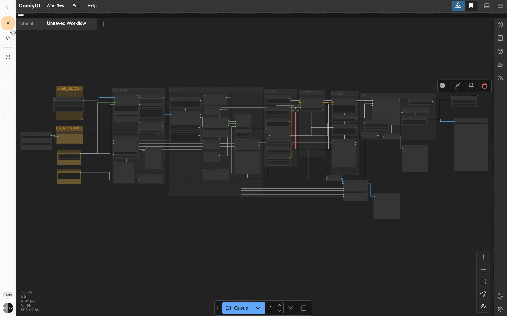
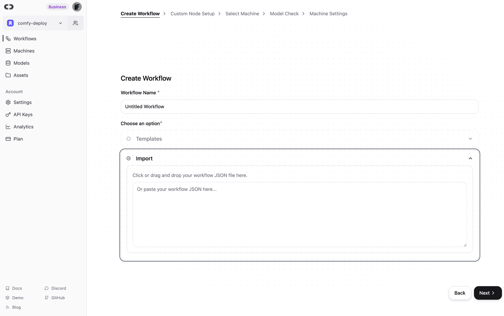
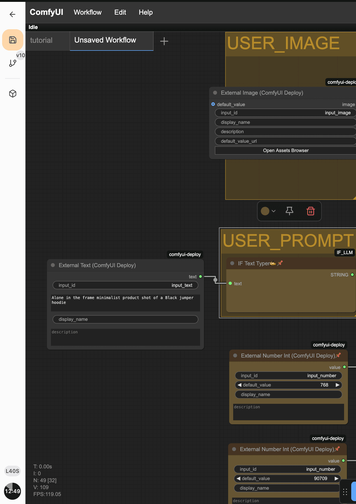
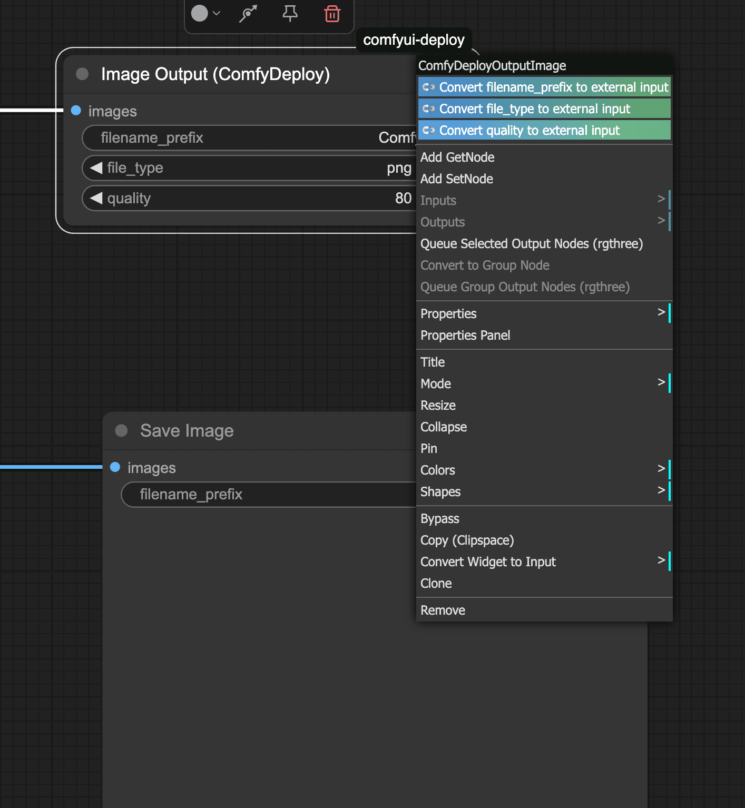
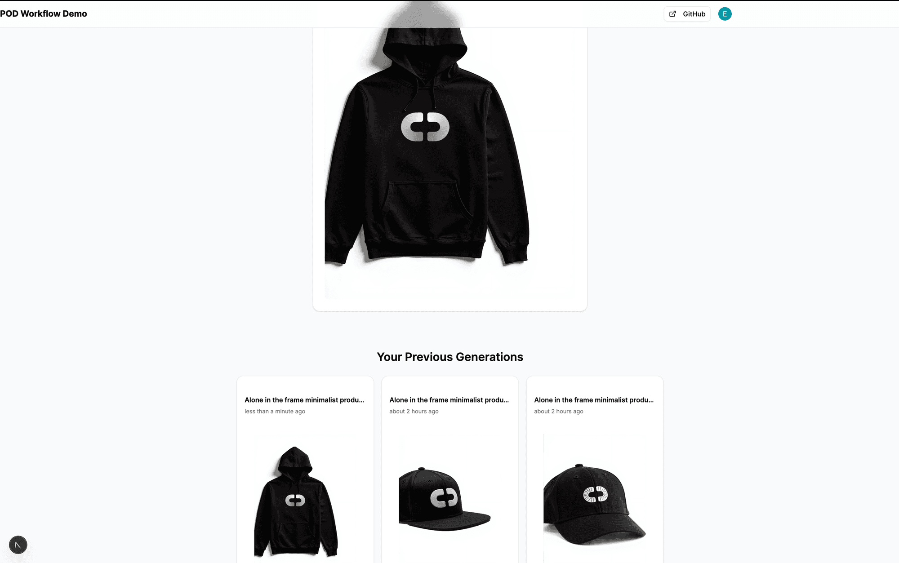

This tutorial will guide you through building a full-stack "Print on Demand" (POD) style workflow application from scratch. Users can upload a logo, provide a text prompt, select an image size, and generate a product mockup using a ComfyUI workflow deployed via ComfyDeploy.

You can use your own workflow and adapt this app to your workflow. As long as you follow the same principles, it will work.

You can find the code for this app on this repo:
[https://github.com/if-ai/comfy-pod-workflow-fullstack](https://github.com/if-ai/comfy-pod-workflow-fullstack)
to



The full workflow is available on the root of the project as POD\_workflow, and it includes the machine data

You can drag or import the workflow, and it will even create the needed machine for it to work. If you deploy into production , you can even scale the GPUs as needed



The application will feature:

- **Next.js 14+** with the App Router
- **ComfyDeploy** for AI image generation via its API
- **Image Uploads** converted to base64 for ComfyDeploy input
- **User Authentication** using Clerk
- **Database** using Drizzle ORM with SQLite (for local development) and compatibility with Turso (for production) to store run history
- **UI Components** from Shadcn/UI
- **Real-time Progress Updates** and image display
- **Webhook Integration** for status updates from ComfyDeploy
- **(Optional) Localtunnel** for testing webhooks locally

This project is inspired by the architecture of applications like the `comfy-deploy-comfydeploy-fullstack-demo`.

[GitHub - comfy-deploy/comfydeploy-fullstack-demo](https://github.com/comfy-deploy/comfydeploy-fullstack-demo)
## Prerequisites

Before you begin, ensure you have the following installed/set up:

- Node.js (latest LTS version recommended)
- Bun (as the package manager/runtime) or npm/yarn
- A ComfyDeploy account ([comfydeploy.com](https://www.comfydeploy.com/))
- A ComfyUI workflow suitable for this POD task, deployed on ComfyDeploy. You'll need its **Deployment ID**.
- An API Key from ComfyDeploy.
- A Clerk account ([clerk.com](https://clerk.com/)) for user authentication. You'll need your **Publishable Key** and **Secret Key**.
- (Optional) A Turso account ([turso.tech](https://turso.tech/)) if you plan to use Turso for your production database.

## Understanding Your ComfyUI Workflow for API Use

For this application to work, your ComfyUI workflow needs to be set up to accept inputs via the ComfyDeploy API and to output the final image in a way we can retrieve.



comfy deploy external nodes carry also api metadata

**1\. External Input Nodes (ComfyUI Deploy):**
ComfyDeploy provides special "External Input" nodes that you add to your ComfyUI workflow. These nodes expose parameters that can be set when you call the API. For our POD workflow, you'll typically need:

- `**ComfyUIDeployExternalImage**`: This node will receive our uploaded logo. You'll give it an `input_id` (e.g., "input\_image"). It can accept image URLs or base64 encoded image data.
- `**ComfyUIDeployExternalText**`: For the user's text prompt. Give it an `input_id` (e.g., "input\_text").
- `**ComfyUIDeployExternalNumberInt**`: For selecting the image size. Give it an `input_id` (e.g., "input\_number").

**Example:** In your ComfyUI workflow, you'd replace a standard "Load Image" node with a `ComfyUIDeployExternalImage` node and connect its output to where the original image was used.



you can also right click on a node and convert it as external

**2\. Output Nodes:**
ComfyDeploy needs to know which image is the final output. You have a couple of options:

- `**ComfyDeployOutputImage**` **Node**: This is a special node provided by ComfyDeploy. You connect your final image to this node in your workflow. This is often the recommended way as it clearly designates an output for API purposes.
- Standard `**SaveImage**` **Node**: You can also use a standard `SaveImage` node.

**Identifying the Output Node ID:**
When ComfyDeploy runs your workflow, it provides an array of outputs from various nodes. To get your final image, you need to identify the specific `node_id` (a number, like "343" in our case) or a unique `output_id` (a string you can define on some output nodes) of the node that produces the final image.

You can find this ID by:

- Inspecting the workflow's JSON definition (which you provided earlier).
- Running the workflow once via the ComfyDeploy UI or API and inspecting the JSON response for the `outputs` array. Look for the node that has your final image URL. The `node_meta.node_id` or a top-level `node_id` or `output_id` on the output object will be what you need.

For our application, we discovered the target image output was associated with `node_meta.node_id: "343"` for the `ComfyDeployOutputImage` node.

You can read more about it in the documentation:
[https://www.comfydeploy.com/docs/v2/introduction](https://www.comfydeploy.com/docs/v2/introduction)

Let's start building!

## Step 1: Create a New Next.js Project

Open your terminal and run:

When prompted:

- Would you like to use TypeScript? **Yes**
- Would you like to use ESLint? **Yes**
- Would you like to use Tailwind CSS? **Yes**
- Would you like to use `src/` directory? **Yes**
- Would you like to use App Router? **Yes**
- Would you like to customize the default import alias (@/\*)? **No** (or your preference)

Navigate into your new project directory:

```
cd
```

## Step 2: Install Dependencies

Install the necessary production and development dependencies using Bun:

**Production Dependencies:**

_(Note:_ `_next-wrap_` _was added implicitly by some operations, ensure it's there if issues arise, otherwise it might not be strictly needed if your Next.js version handles its functionality)._

**Development Dependencies:**

```
bun add -D
```

## Step 3: Set Up Environment Variables & Validation

Environment variables are crucial for storing sensitive keys and configuration.

**Import Environment Validation in** `**next.config.mjs**`**:**
To ensure environment variables are validated at build time and when the dev server starts, import the `env.ts` file at the top of your `next.config.mjs`:

```
// next.config.mjs
import './src/types/env.ts'; // This should be the first import

/** @type {import('next').NextConfig} */
const nextConfig = {
  // Your Next.js config options here
  // e.g., images, experimental features, etc.
  // Add turbopack rules if you plan to use them, like in the demo
  // turbopack: {
  //   rules: {},
  // },
};

export default nextConfig;
```

**Create** `**src/types/env.ts**` **for Validation:**
This file will use Zod to validate that all required environment variables are present and correctly formatted when the application starts.

```
// src/types/env.ts
import { z, type TypeOf } from "zod";

const zodEnv = z.object({
    COMFY_DEPLOY_API_KEY: z.string().min(1, "COMFY_DEPLOY_API_KEY is required"),
    COMFY_DEPLOY_WF_DEPLOYMENT_ID: z.string().min(1, "COMFY_DEPLOY_WF_DEPLOYMENT_ID is required"),

    DATABASE_URL: z.string().min(1, "DATABASE_URL is required"),
    DATABASE_AUTH_TOKEN: z.string().optional(), // Optional for local SQLite

    NEXT_PUBLIC_CLERK_PUBLISHABLE_KEY: z.string().min(1, "NEXT_PUBLIC_CLERK_PUBLISHABLE_KEY is required"),
    CLERK_SECRET_KEY: z.string().min(1, "CLERK_SECRET_KEY is required"),
    NEXT_PUBLIC_CLERK_SIGN_IN_URL: z.string().default("/sign-in"),
    NEXT_PUBLIC_CLERK_SIGN_UP_URL: z.string().default("/sign-up"),
});

try {
    zodEnv.parse(process.env);
} catch (err) {
    if (err instanceof z.ZodError) {
        const { fieldErrors } = err.flatten();
        const errorMessage = Object.entries(fieldErrors)
            .map(([field, errors]) =>
                errors ? `${field}: ${errors.join(", ")}` : field,
            )
            .join("\n  ");
        console.error(`❌ Missing or invalid environment variables:\n  ${errorMessage}`);
        process.exit(1); // Exit if validation fails
    }
}

// Augment NodeJS.ProcessEnv to include our validated types
declare global {
    namespace NodeJS {
        interface ProcessEnv extends TypeOf<typeof zodEnv> {}
    }
}
```

**Create** `**.env.local**`**:**
In the root of your project, create a file named `.env.local` and add the following, replacing the placeholder values with your actual keys and IDs:

## Step 4: Set Up Clerk Authentication

Clerk will handle user sign-up, sign-in, and session management.

**Create Sign-In Page** `**src/app/sign-in/[[...sign-in]]/page.tsx**`**:**
Clerk provides UI components for sign-in.

```
// src/app/sign-in/[[...sign-in]]/page.tsx
import { SignIn } from "@clerk/nextjs";

export default function Page() {
    return (
        <div className="flex justify-center items-center h-screen">
            <SignIn path="/sign-in" routing="path" />
        </div>
    );
}
```

(You can create a similar `src/app/sign-up/[[...sign-up]]/page.tsx` if you want a dedicated sign-up page, though Clerk's default modals can handle it too.)

**Create** `**src/middleware.ts**`**:**
This middleware protects routes and defines public routes that don't require authentication.

```
// src/middleware.ts
import { clerkMiddleware, createRouteMatcher } from "@clerk/nextjs/server";

// Define public routes that don't require authentication
const isPublicRoute = createRouteMatcher([
    '/', // Making the home page public
    '/sign-in(.*)',
    '/sign-up(.*)',
    '/api/webhook(.*)' // Webhooks must be public to receive POSTs from ComfyDeploy
]);

export default clerkMiddleware((auth, req) => {
    if (!isPublicRoute(req)) {
        auth().protect(); // Protect all other routes
    }
});

export const config = {
    matcher: ["/((?!.+\\.[\\w]+$|_next).*)", "/", "/(api|trpc)(.*)"],
};
```

## Step 5: Set Up Database (Drizzle ORM with SQLite/Turso)

We'll use Drizzle ORM to interact with our database. Locally, we'll use SQLite, and for production, you can switch to Turso.

1. **Storing Run History**: To show users their past generations.
    - **Associating Runs with Users**: Linking each run to a `user_id` from Clerk.
    - **Persistence of Results**: Storing the `image_url` results provides more control than relying solely on ComfyDeploy's temporary storage.
    - `db:generate`: Uses `dotenv-cli` to load `.env.local` and then runs `drizzle-kit generate` to create SQL migration files based on schema changes.
    - `db:migrate`: Runs our `migrate.ts` script to apply migrations.
    - `db:studio`: Opens Drizzle Studio to inspect your local database.
2. **Generate and Run Initial Migration:**

3.

Apply the migration to your database (this creates `local.db` if it doesn't exist):

Generate migration files:

This will create a `migrations` folder with SQL files.

**Add Scripts to** `**package.json**`**:**
Update the `scripts` section in your `package.json`:

```
{
  // ... other package.json content ...
  "scripts": {
    "dev:next": "next dev --turbopack", // Or just "next dev"
    "dev:tunnel": "bun run localtunnel.mjs",
    "dev": "concurrently --kill-others --prefix none \\\"bun run dev:next\\\" \\\"bun run dev:tunnel\\\"",
    "build": "next build",
    "start": "next start",
    "lint": "next lint",
    "db:generate": "dotenv -e .env.local -- bunx drizzle-kit generate",
    "db:migrate": "bun run src/db/migrate.ts",
    "db:studio": "drizzle-kit studio"
  },
  // ... rest of package.json ...
}
```

**Create Drizzle Kit Configuration** `**drizzle.config.ts**`**:**
This file is for Drizzle Kit, the CLI tool for generating and managing migrations.

```
// drizzle.config.ts
import type { Config } from 'drizzle-kit';
import 'dotenv/config';     // Ensure .env.local is loaded for Drizzle Kit
import "./src/types/env";  // Validate env vars

export default {
    out: './migrations',             // Folder for migration files
    schema: './src/db/schema.ts',    // Path to your schema file
    breakpoints: true,
    dbCredentials: {
        url: process.env.DATABASE_URL!, // Drizzle Kit needs this directly
    },
    dialect: 'sqlite', // Specifies the SQL dialect (works for Turso too, which is SQLite-compatible)
} satisfies Config;
```

**Create Migration Script** `**src/db/migrate.ts**`**:**
This script will apply schema changes to the database.

```
// src/db/migrate.ts
import { migrate } from "drizzle-orm/libsql/migrator";
import { drizzle } from "drizzle-orm/libsql";
import { createClient } from "@libsql/client";
import "dotenv/config";    // Load .env.local for the script
import "../types/env";     // Validate environment variables before migrating

async function main() {
    const dbClient = createClient({
        url: process.env.DATABASE_URL!,
        authToken: process.env.DATABASE_AUTH_TOKEN,
    });
    const db = drizzle(dbClient);

    console.log("⏳ Running migrations...");
    // This will create and read from a `./migrations` folder
    await migrate(db, { migrationsFolder: "./migrations" });
    console.log("✅ Migrations completed.");
    process.exit(0);
}

main().catch((err) => {
    console.error("❌ Migration failed:", err);
    process.exit(1);
});
```

**Create Drizzle Client** `**src/db/db.ts**`**:**

```
// src/db/db.ts
import { createClient } from "@libsql/client";
import { drizzle } from "drizzle-orm/libsql";
import * as schema from "./schema";

// Create the database client
const client = createClient({
    url: process.env.DATABASE_URL!,
    authToken: process.env.DATABASE_AUTH_TOKEN, // Will be undefined for local SQLite, which is fine
});

// Initialize Drizzle with the client and schema
export const db = drizzle(client, { schema });
```

**Define Database Schema** `**src/db/schema.ts**`**:**
This file defines the structure of our `runs` table.

```
// src/db/schema.ts
import { sql } from "drizzle-orm";
import { integer, sqliteTable, text, real } from "drizzle-orm/sqlite-core";

export const runs = sqliteTable("runs", {
    run_id: text("run_id").notNull().primaryKey(), // From ComfyDeploy
    user_id: text("user_id").notNull(), // From Clerk
    createdAt: integer("created_at", { mode: "timestamp" }).default(
        sql`(strftime('%s', 'now'))` // SQLite function for current Unix timestamp in seconds
    ),
    image_url: text("image_url"), // To be updated by webhook
    inputs: text("inputs", { mode: "json" }).$type<Record<string, any>>(), // Store inputs as JSON
    live_status: text("live_status"), // e.g., "running", "succeeded"
    progress: real("progress"), // e.g., 0.0 to 1.0
});
```

_Why a Database?_

## Step 6: Set Up Shadcn/UI

Shadcn/UI provides beautifully designed components that you can copy and paste into your project.

1. Choose your preferred style (e.g., Default or New York).
    - Select a base color (e.g., Slate or Neutral).
    - Confirm CSS variable settings.
    - It will auto-detect paths like `tailwind.config.ts` `src/app/globals.css`. Accept the defaults or adjust if your setup is different.
        This will create `src/lib/utils.ts` the `src/components/ui/` directory.

**Add Required Components:**

This will add the specified components into `src/components/ui/`.

**Initialize Shadcn/UI:**

Answer the prompts:

## Step 7: Create Core Application Structure and Layout

**Modify Root Layout** `**src/app/layout.tsx**`**:**
Wrap the application with necessary providers.

```
// src/app/layout.tsx
import type { Metadata } from "next";
import { Inter } from "next/font/google";
import "./globals.css";
import { ClerkProvider } from "@clerk/nextjs";
import { Toaster } from "@/components/ui/sonner"; // from shadcn
import { QueryProvider } from "@/hooks/QueryProvider"; // Your QueryProvider

const inter = Inter({ subsets: ["latin"] });

export const metadata: Metadata = {
    title: "Comfy POD Workflow Demo",
    description: "Generate product mockups with your logo using ComfyDeploy.",
};

export default function RootLayout({
    children,
}: Readonly<{
    children: React.ReactNode;
}>) {
    return (
        <ClerkProvider>
            <html lang="en" suppressHydrationWarning> {/* suppressHydrationWarning good for next-themes if used */}
                <QueryProvider>
                    <body className={inter.className}>
                        {children}
                        <Toaster /> {/* For displaying notifications */}
                    </body>
                </QueryProvider>
            </html>
        </ClerkProvider>
    );
}
```

**Create** `**QueryProvider**` **for TanStack Query:**
`@tanstack/react-query` is used for client-side data fetching and caching, especially for polling run status.

```
// src/hooks/QueryProvider.tsx
"use client";

import { QueryClient, QueryClientProvider } from "@tanstack/react-query";
import { useState, type ReactNode } from "react";

export function QueryProvider({ children }: { children: ReactNode }) {
    const [queryClient] = useState(() => new QueryClient());
    return (
        <QueryClientProvider client={queryClient}>
            {children}
        </QueryClientProvider>
    );
}
```

## Step 8: Create Backend API Routes

These routes handle communication with ComfyDeploy and the database.

**Route to List User's Runs (**`**src/app/api/runs/route.ts**`**):**
Fetches historical runs for the logged-in user.

```
// src/app/api/runs/route.ts
import { db } from "@/db/db";
import { runs } from "@/db/schema";
import { auth } from "@clerk/nextjs/server";
import { desc, eq } from "drizzle-orm";
import { NextRequest, NextResponse } from "next/server";

export async function GET(request: NextRequest) {
    const authResult = await auth();
    const userId = authResult.userId;
    if (!userId) {
        return NextResponse.json({ error: "Unauthorized" }, { status: 401 });
    }

    try {
        const userRuns = await db
            .select()
            .from(runs)
            .where(eq(runs.user_id, userId))
            .orderBy(desc(runs.createdAt)); // Show newest first

        return NextResponse.json(userRuns);
    } catch (error) {
        console.error("Error fetching user runs:", error);
        return NextResponse.json({ error: "Internal server error" }, { status: 500 });
    }
}
```

**Route for Webhooks (**`**src/app/api/webhook/route.ts**`**):**
ComfyDeploy sends POST requests to this endpoint when run events occur.

```
// src/app/api/webhook/route.ts
import { db } from "@/db/db";
import { runs } from "@/db/schema";
import { eq } from "drizzle-orm";
import { NextRequest, NextResponse } from "next/server";
import { findOutputImageById } from "@/lib/findOutputImage"; // Shared helper

export async function POST(request: NextRequest) {
    let payload;
    try {
        payload = await request.json();
    } catch (error) {
        console.error("Webhook: Invalid JSON payload", error);
        return NextResponse.json({ message: "Invalid JSON payload" }, { status: 400 });
    }

    console.log("Webhook received:", JSON.stringify(payload, null, 2));

    const { run_id, status, outputs, live_status, progress, event_type } = payload;

    if (!run_id) {
        console.error("Webhook: Missing run_id in payload");
        return NextResponse.json({ message: "Missing run_id" }, { status: 400 });
    }

    try {
        const updateData: Partial<typeof runs.$inferInsert> = {};

        if (live_status !== undefined) updateData.live_status = live_status;
        if (progress !== undefined) updateData.progress = progress;

        if (event_type === "run.output" || (event_type === "run.updated" && status === "success")) {
            // Use the node_id identified from your workflow (e.g., "343")
            const imageUrl = findOutputImageById(outputs, "343") || // Primary
                             findOutputImageById(outputs, "final_result") || // Fallback
                             findOutputImageById(outputs, "126"); // Another fallback (e.g. SaveImage node)

            if (imageUrl) {
                updateData.image_url = imageUrl;
                console.log(`Webhook: Updating run ${run_id} with image URL: ${imageUrl}`);
            } else {
                console.log(`Webhook: Run ${run_id} ${status}, but final image URL not found in outputs.`);
            }
        }

        if (Object.keys(updateData).length > 0) {
            await db.update(runs)
                .set(updateData)
                .where(eq(runs.run_id, run_id));
            console.log(`Webhook: DB updated for run_id ${run_id} with data:`, updateData);
        }

        return NextResponse.json({ message: "Webhook processed successfully" }, { status: 200 });

    } catch (error) {
        console.error(`Webhook: Error processing run_id ${run_id}:`, error);
        return NextResponse.json({ message: "Webhook acknowledged, internal processing error" }, { status: 200 });
    }
}
```

**Route to Get Run Status (**`**src/app/api/run/[run_id]/route.ts**`**):**
This endpoint is polled by the frontend to get live updates on a run.

```
// src/app/api/run/[run_id]/route.ts
import { auth } from "@clerk/nextjs/server";
import { NextRequest, NextResponse } from "next/server";

const COMFY_API_BASE_URL = "https://api.comfydeploy.com"; // Base URL for direct API calls

export async function GET(
    request: NextRequest,
    { params }: { params: { run_id: string } } // { params } is the standard way to get dynamic route segments
) {
    const authResult = await auth();
    const userId = authResult.userId;
    if (!userId) {
        return NextResponse.json({ error: "Unauthorized" }, { status: 401 });
    }

    const { run_id } = params; // Destructure run_id from params
    if (!run_id) {
        return NextResponse.json({ error: "Missing run_id" }, { status: 400 });
    }

    try {
        // Using fetch directly as per original plan; could be refactored to cd.run.get()
        const apiResponse = await fetch(`${COMFY_API_BASE_URL}/api/run/${run_id}?queue_position=true`, {
            headers: {
                'Authorization': `Bearer ${process.env.COMFY_DEPLOY_API_KEY!}`
            }
        });

        if (!apiResponse.ok) {
            const errorText = await apiResponse.text();
            return NextResponse.json({ error: `Failed to fetch run status: ${errorText}` }, { status: apiResponse.status });
        }

        const jsonData = await apiResponse.json();
        // Extract only the fields needed by the frontend
        const { live_status, status, outputs, progress, queue_position } = jsonData;
        return NextResponse.json({ live_status, status, outputs, progress, queue_position });

    } catch (error) {
        console.error("Error fetching ComfyDeploy run status:", error);
        return NextResponse.json({ error: "Internal server error" }, { status: 500 });
    }
}
```

**Route to Queue a Run (**`**src/app/api/run/route.ts**`**):**
This endpoint receives user inputs, queues a run with ComfyDeploy, and records it in the database.

```
// src/app/api/run/route.ts
import { db } from "@/db/db";
import { runs } from "@/db/schema";
import { auth } from "@clerk/nextjs/server";
import { NextRequest, NextResponse } from "next/server";
import { headers as nextHeaders } from "next/headers"; // Renamed to avoid conflict
import { promises as fs } from 'node:fs';
import { ComfyDeploy } from "comfydeploy";

// Initialize ComfyDeploy client with your API key
const cd = new ComfyDeploy({
    bearer: process.env.COMFY_DEPLOY_API_KEY!,
});

const isDevelopment = process.env.NODE_ENV === "development";

// Helper to determine the correct webhook endpoint (handles localtunnel in dev)
async function getEndpoint() {
    const headersList = await nextHeaders(); // Use the renamed import
    const host = headersList.get("host") || "";
    const protocol = headersList.get("x-forwarded-proto") || (host.includes("localhost") ? "http" : "https");
    let endpoint = `${protocol}://${host}`;

    if (isDevelopment && host.includes("localhost")) {
        const tunnelUrlFilePath = "tunnel_url.txt"; // Written by localtunnel.mjs
        try {
            const tunnelUrl = await fs.readFile(tunnelUrlFilePath, "utf-8");
            endpoint = tunnelUrl.trim();
            console.log("Using tunnel URL for webhook:", endpoint);
        } catch (error) {
            console.warn(
                `localtunnel: Failed to read tunnel URL from ${tunnelUrlFilePath}. Using host: ${endpoint}. Error: ${error instanceof Error ? error.message : String(error)}`,
            );
        }
    }
    return endpoint;
}

export async function POST(request: NextRequest) {
    const authResult = await auth();
    const userId = authResult.userId;
    if (!userId) {
        return NextResponse.json({ error: "Unauthorized" }, { status: 401 });
    }

    const reqBody = await request.json();
    const { logoUrl, promptText, imageSize } = reqBody; // logoUrl is base64 data

    if (!logoUrl || !promptText || !imageSize) {
        return NextResponse.json({ error: "Missing required fields" }, { status: 400 });
    }

    // Map to your ComfyDeploy workflow's input names
    const comfyInputs = {
        input_image: logoUrl,       // Base64 data URL for the logo
        input_text: promptText,     // User's prompt
        input_number: parseInt(imageSize, 10), // Selected image size
    };

    const webhookUrl = `${await getEndpoint()}/api/webhook?target_events=run.output,run.updated`;
    console.log("Webhook will be sent to:", webhookUrl);

    try {
        const response = await cd.run.deployment.queue({
            deploymentId: process.env.COMFY_DEPLOY_WF_DEPLOYMENT_ID!,
            webhook: webhookUrl,
            inputs: comfyInputs,
        });

        if (response && response.runId) {
            const runId = response.runId;
            await db.insert(runs).values({
                run_id: runId,
                user_id: userId,
                inputs: comfyInputs, // Store the inputs we sent
            });
            return NextResponse.json({ run_id: runId });
        } else {
            console.error("ComfyDeploy SDK error: No runId in response or response is unexpected.", response);
            let errorMessage = "Failed to create run: Unexpected response from ComfyDeploy SDK.";
             if (typeof response === 'object' && response !== null && 'error' in response && typeof (response as any).error === 'string') {
                errorMessage = `Failed to create run: ${(response as any).error}`;
            }
            return NextResponse.json({ error: errorMessage }, { status: 500 });
        }
    } catch (error: any) {
        console.error("Error calling ComfyDeploy SDK or DB:", error);
        let detail = "Internal server error";
        if (error.message) {
            detail = error.message;
        }
        if (error.response && error.response.data && error.response.data.detail) {
            detail = error.response.data.detail;
        }
        return NextResponse.json({ error: detail }, { status: 500 });
    }
}
```

## Step 9: Create Frontend Components

**User Runs History Component (**`**src/components/UserRuns.tsx**`**):**
Displays a grid of previously generated images for the logged-in user.

```
// src/components/UserRuns.tsx
"use client";

import { useQuery } from "@tanstack/react-query";
import { ImageGenerationResult } from "./ImageGenerationResult";
import { Card, CardContent, CardDescription, CardHeader, CardTitle } from "./ui/card"; // Assuming Card components are in ./ui/card
import { Skeleton } from "./ui/skeleton"; // Assuming Skeleton is in ./ui/skeleton
import { AlertTriangle, Sparkle } from "lucide-react";
import { formatDistanceToNow } from 'date-fns';

interface Run {
    run_id: string;
    createdAt: number | Date | string; // Allow string for more flexible parsing
    image_url: string | null;
    inputs: Record<string, any>;
    live_status?: string | null;
    progress?: number | null;
}

export function UserRuns() {
    const { data: userRuns, isLoading, error } = useQuery<Run[]>({
        queryKey: ["userRuns"],
        queryFn: () => fetch("/api/runs").then((res) => {
            if (!res.ok) throw new Error("Failed to fetch runs");
            return res.json();
        }),
        // RefetchInterval can be adjusted or made dependent on window focus
        refetchInterval: 30000, // e.g., every 30 seconds
    });

    if (isLoading) {
        return (
            <div className="w-full max-w-4xl mx-auto mt-8">
                <Skeleton className="h-10 w-1/3 mb-6" />
                <div className="grid grid-cols-1 sm:grid-cols-2 lg:grid-cols-3 gap-4">
                    {[...Array(3)].map((_, i) => (
                        <Skeleton key={i} className="h-72 w-full rounded-lg" />
                    ))}
                </div>
            </div>
        );
    }

    if (error) {
        return (
            <div className="w-full max-w-3xl mx-auto mt-8 p-4 bg-red-100 border border-red-400 text-red-700 rounded-md flex items-center">
                <AlertTriangle className="h-5 w-5 mr-3" />
                <p>Error loading your previous generations. Please try again later.</p>
            </div>
        );
    }

    if (!userRuns || userRuns.length === 0) {
        return (
            <div className="w-full max-w-3xl mx-auto mt-12 text-center text-gray-500">
                <Sparkle size={32} className="mx-auto mb-3 text-gray-400" />
                <p className="text-lg">You haven't generated any images yet.</p>
                <p className="text-sm">Start creating to see your history here!</p>
            </div>
        );
    }

    return (
        <div className="w-full max-w-4xl mx-auto mt-8 space-y-6 pb-16">
            <h2 className="text-2xl font-semibold text-center mb-6">Your Previous Generations</h2>
            <div className="grid grid-cols-1 sm:grid-cols-2 lg:grid-cols-3 gap-4">
                {userRuns.map((run) => (
                    <Card key={run.run_id} className="overflow-hidden group relative shadow-sm hover:shadow-md transition-shadow">
                        <CardHeader className="p-4">
                             <CardTitle className="text-sm truncate" title={run.inputs?.input_text || 'Prompt N/A'}>
                                {run.inputs?.input_text || 'Unnamed Run'}
                            </CardTitle>
                            <CardDescription className="text-xs">
                                {run.createdAt ?
                                    formatDistanceToNow(
                                        typeof run.createdAt === 'number' ? new Date(run.createdAt * 1000) : new Date(run.createdAt),
                                        { addSuffix: true }
                                    )
                                    : 'Date N/A'}
                            </CardDescription>
                        </CardHeader>
                        <CardContent className="p-0">
                            {run.image_url ? (
                                <NextImage // Using NextImage for optimization
                                    src={run.image_url}
                                    alt={`Generated image for run ${run.run_id.substring(0,8)}`}
                                    width={512} // Provide appropriate dimensions
                                    height={512}
                                    className="w-full h-auto object-cover aspect-square"
                                />
                            ) : (
                                <ImageGenerationResult runId={run.run_id} className="aspect-square" />
                            )}
                        </CardContent>
                         <div className="absolute inset-0 bg-black/80 p-4 opacity-0 group-hover:opacity-100 transition-opacity duration-300 flex flex-col justify-end text-white text-xs overflow-y-auto">
                            {run.inputs && Object.entries(run.inputs).map(([key, value]) => (
                                (key === "input_image" && typeof value === "string" && value.startsWith("data:image")) ? null : // Skip showing base64 for input_image
                                <div key={key} className="mb-1">
                                    <span className="font-semibold capitalize">{key.replace(/_/g, ' ')}:</span>
                                    <span className="ml-1 break-all">{typeof value === 'object' ? JSON.stringify(value) : String(value)}</span>
                                </div>
                            ))}
                        </div>
                    </Card>
                ))}
            </div>
        </div>
    );
}
```

**Main Application UI (**`**src/components/PodWorkflowApp.tsx**`**):**
This component provides the form for logo upload, prompt, and size selection.

```
// src/components/PodWorkflowApp.tsx
"use client";

import { Button } from "@/components/ui/button";
import { Card, CardContent, CardHeader, CardTitle } from "@/components/ui/card";
import { Input } from "@/components/ui/input"; // For prompt text
import { Label } from "@/components/ui/label";
import { Select, SelectContent, SelectItem, SelectTrigger, SelectValue } from "@/components/ui/select";
import { WandSparklesIcon, UploadCloudIcon, XIcon } from "lucide-react";
import { useState, FormEvent, ChangeEvent, useRef } from "react";
import { toast } from "sonner";
import { ImageGenerationResult } from "./ImageGenerationResult";
import { useQueryClient } from "@tanstack/react-query";
import NextImage from 'next/image'; // Renamed to avoid conflict if any

export function PodWorkflowApp() {
    const [selectedFile, setSelectedFile] = useState<File | null>(null);
    const [base64LogoDataUrl, setBase64LogoDataUrl] = useState<string | null>(null);
    const fileInputRef = useRef<HTMLInputElement>(null);

    const [promptText, setPromptText] = useState<string>("Alone in the frame minimalist product shot of a Black baseball cap.");
    const [imageSize, setImageSize] = useState<string>("768"); // Default size
    const [isLoading, setIsLoading] = useState(false); // For main generation button
    const [isUploading, setIsUploading] = useState(false); // For logo processing
    const [currentRunId, setCurrentRunId] = useState<string | null>(null);
    const queryClientHook = useQueryClient();

    const handleFileChange = (event: ChangeEvent<HTMLInputElement>) => {
        const file = event.target.files?.[0];
        if (file) {
            if (file.size > 4 * 1024 * 1024) { // Example: 4MB limit
                toast.error("File is too large. Please select a file smaller than 4MB.");
                if (fileInputRef.current) fileInputRef.current.value = ""; // Reset input
                return;
            }
            setSelectedFile(file);
            setIsUploading(true);
            const reader = new FileReader();
            reader.onloadend = () => {
                setBase64LogoDataUrl(reader.result as string);
                setIsUploading(false);
                toast.success("Logo selected: " + file.name);
            };
            reader.onerror = () => {
                setIsUploading(false);
                setSelectedFile(null);
                toast.error("Failed to read file.");
            }
            reader.readAsDataURL(file);
        }
    };

    const clearLogoSelection = () => {
        setSelectedFile(null);
        setBase64LogoDataUrl(null);
        if (fileInputRef.current) {
            fileInputRef.current.value = "";
        }
    };

    const handleSubmit = async (e: FormEvent) => {
        e.preventDefault();
        if (!base64LogoDataUrl) {
            toast.error("Please select a logo image to upload.");
            return;
        }
        if (!promptText.trim()) {
            toast.error("Please enter a prompt.");
            return;
        }
        setIsLoading(true);
        setCurrentRunId(null); // Clear previous run display

        try {
            const response = await fetch("/api/run", {
                method: "POST",
                headers: { "Content-Type": "application/json" },
                body: JSON.stringify({ logoUrl: base64LogoDataUrl, promptText, imageSize }),
            });

            if (!response.ok) {
                const errorData = await response.json();
                toast.error(`Error: ${errorData.error || "Failed to start generation."}`);
                setIsLoading(false);
                return;
            }

            const data = await response.json();
            if (data.run_id) {
                setCurrentRunId(data.run_id);
                toast.success("Generation started! Run ID: " + data.run_id);
                queryClientHook.invalidateQueries({ queryKey: ["userRuns"] });
            } else {
                toast.error("Failed to get Run ID from server.");
            }
        } catch (error: any) {
            toast.error(`An unexpected error occurred: ${error.message}`);
            console.error(error);
        } finally {
            setIsLoading(false);
        }
    };

    return (
        <div className="w-full max-w-xl mx-auto space-y-6">
            <Card>
                <CardHeader>
                    <CardTitle>POD Workflow Generator</CardTitle>
                </CardHeader>
                <CardContent>
                    <form onSubmit={handleSubmit} className="space-y-6">
                        <div>
                            <Label htmlFor="logoFile">Logo Image (PNG, JPG, WEBP, <4MB)</Label>
                            <div className="mt-1 flex items-center space-x-2">
                                <Button
                                    type="button"
                                    variant="outline"
                                    onClick={() => fileInputRef.current?.click()}
                                    disabled={isUploading}
                                >
                                    <UploadCloudIcon className="mr-2 h-4 w-4" />
                                    {isUploading ? "Processing..." : (base64LogoDataUrl ? "Change Logo" : "Upload Logo")}
                                </Button>
                                <input
                                    id="logoFile"
                                    type="file"
                                    accept="image/png, image/jpeg, image/webp"
                                    onChange={handleFileChange}
                                    className="hidden"
                                    ref={fileInputRef}
                                />
                                {base64LogoDataUrl && (
                                    <Button
                                        type="button"
                                        variant="ghost"
                                        size="icon"
                                        onClick={clearLogoSelection}
                                        title="Clear selection"
                                        disabled={isUploading}
                                    >
                                        <XIcon className="h-4 w-4" />
                                    </Button>
                                )}
                            </div>
                            {base64LogoDataUrl && (
                                <div className="mt-4 p-2 border rounded-md w-32 h-32 relative overflow-hidden bg-slate-50">
                                    <NextImage src={base64LogoDataUrl} alt="Logo preview" layout="fill" objectFit="contain" />
                                </div>
                            )}
                        </div>

                        <div>
                            <Label htmlFor="promptText">Prompt</Label>
                            <Input
                                id="promptText"
                                value={promptText}
                                onChange={(e) => setPromptText(e.target.value)}
                                placeholder="Enter your prompt"
                                required
                            />
                        </div>
                        <div>
                            <Label htmlFor="imageSize">Image Size (Square)</Label>
                            <Select value={imageSize} onValueChange={setImageSize}>
                                <SelectTrigger id="imageSize" className="w-full">
                                    <SelectValue placeholder="Select size" />
                                </SelectTrigger>
                                <SelectContent>
                                    <SelectItem value="512">512x512</SelectItem>
                                    <SelectItem value="768">768x768</SelectItem>
                                    <SelectItem value="1024">1024x1024</SelectItem>
                                </SelectContent>
                            </Select>
                        </div>
                        <Button
                            type="submit"
                            disabled={isLoading || isUploading || !base64LogoDataUrl}
                            className="w-full"
                        >
                            {isLoading ? "Generating..." : (<><WandSparklesIcon className="mr-2 h-4 w-4" /> Generate Image</>)}
                        </Button>
                    </form>
                </CardContent>
            </Card>

            {currentRunId && (
                <Card className="mt-6">
                    <CardHeader>
                        <CardTitle>Generation Result (Run ID: {currentRunId.substring(0,8)}...)</CardTitle>
                    </CardHeader>
                    <CardContent>
                        <ImageGenerationResult runId={currentRunId} />
                    </CardContent>
                </Card>
            )}
        </div>

```

**Image Generation Result Component (**`**src/components/ImageGenerationResult.tsx**`**):**
Displays progress and the final (or preview) image.

```
// src/components/ImageGenerationResult.tsx
"use client";

import { Progress } from "@/components/ui/progress";
import { Skeleton } from "@/components/ui/skeleton";
import { findOutputImageById } from "@/lib/findOutputImage";
import { cn } from "@/lib/utils";
import { useQuery } from "@tanstack/react-query";
import { motion, AnimatePresence } from "framer-motion";
import { LoaderCircle } from "lucide-react";
import { useEffect, useState } from "react";

export function ImageGenerationResult({
    runId,
    className,
}: { runId: string } & React.ComponentProps<"div">) {
    const [imageUrl, setImageUrl] = useState<string | null>(null);
    const [previewImageUrl, setPreviewImageUrl] = useState<string | null>(null);
    const [currentStatus, setCurrentStatus] = useState<string>("preparing");
    const [currentProgress, setCurrentProgress] = useState<number | undefined>();
    const [liveGenerationStatus, setLiveGenerationStatus] = useState<string | null>(null);
    const [isTerminalStatus, setIsTerminalStatus] = useState(false);
    const [queuePos, setQueuePos] = useState<number | null>(null);

    const { data: runDetails, isLoading: isLoadingDetails } = useQuery({
        queryKey: ["runDetails", runId],
        queryFn: async () => {
            const res = await fetch(`/api/run/${runId}`);
            if (!res.ok) {
                console.error("Failed to fetch run details for runId:", runId);
                return null;
            }
            return res.json();
        },
        refetchInterval: (query) => {
            const data: any = query.state.data;
            // Stop refetching if we have a final image (found via any of our target IDs) or a terminal status
            if (data?.status === "success" && (findOutputImageById(data.outputs, "343") || findOutputImageById(data.outputs, "final_result") || findOutputImageById(data.outputs, "126"))) return false;
            if (["failed", "success", "cancelled", "timeout"].includes(data?.status)) return false;
            return 2000; // Poll every 2 seconds
        },
        enabled: !!runId && !isTerminalStatus,
    });

    useEffect(() => {
        if (runDetails) {
            setCurrentStatus(runDetails.status);
            setCurrentProgress(runDetails.progress);
            setLiveGenerationStatus(runDetails.live_status ?? null);
            setQueuePos(runDetails.queue_position);

            // Attempt to find intermediate/preview image (if your workflow has a node for it, e.g., "intermediate_result")
            const intermediate = findOutputImageById(runDetails.outputs, "intermediate_result");
            if (intermediate) setPreviewImageUrl(intermediate);

            if (runDetails.status === "success") {
                // Try to find the final image using primary and fallback IDs
                const finalImg = findOutputImageById(runDetails.outputs, "343") ||         // Primary (e.g. ComfyDeployOutputImage node)
                                 findOutputImageById(runDetails.outputs, "126") ||         // Secondary (e.g. SaveImage node)
                                 findOutputImageById(runDetails.outputs, "final_result"); // Generic fallback
                if (finalImg) {
                    setImageUrl(finalImg);
                    setIsTerminalStatus(true);
                } else if (runDetails.outputs?.length > 0) {
                    console.warn("Run successful, but expected output image not found. Outputs received:", JSON.stringify(runDetails.outputs, null, 2));
                    setIsTerminalStatus(true); // Still terminal, just no image found
                }
            } else if (["failed", "cancelled", "timeout"].includes(runDetails.status)) {
                setIsTerminalStatus(true);
            }
        }
    }, [runDetails]);

    if (!runId) return null;

    if (isLoadingDetails && !runDetails && !imageUrl) { // Show skeleton if loading and no image yet
        return <Skeleton className={cn("w-full aspect-square relative", className)} />;
    }

    if (imageUrl) {
        return (
            <AnimatePresence mode="wait">
                <motion.img
                    key="final"
                    initial={{ opacity: 0 }}
                    animate={{ opacity: 1 }}
                    transition={{ duration: 0.5 }}
                    className={cn("z-10 w-full h-auto object-contain rounded-md", className)}
                    src={imageUrl}
                    alt="Generated output"
                />
            </AnimatePresence>
        );
    }

    // Display progress, status, queue position
    return (
        <div
            className={cn(
                "w-full aspect-square relative bg-muted rounded-md flex flex-col items-center justify-center p-4 overflow-hidden",
                className,
            )}
        >
            {previewImageUrl && (
                 <div className="absolute inset-0 z-0">
                    <motion.img
                        key="preview"
                        initial={{ opacity: 0 }}
                        animate={{ opacity: 1 }}
                        exit={{ opacity: 0 }}
                        className="w-full h-full object-cover scale-110" // Slight blur/zoom for background effect
                        src={previewImageUrl}
                        alt="Preview"
                    />
                    <div className="absolute inset-0 backdrop-blur-md" /> {/* Blur overlay */}
                </div>
            )}
            <div className="z-10 flex flex-col items-center justify-center gap-2 text-center">
                {queuePos !== null && queuePos > 0 && (
                     <div className="text-xs bg-black/70 text-white px-3 py-1 rounded-full shadow-md mb-2">
                        Queue Position: {queuePos} <LoaderCircle size={12} className="inline animate-spin ml-1" />
                    </div>
                )}
                {(queuePos === null || queuePos === 0) && !isTerminalStatus && (
                    <>
                        <div className="flex items-center justify-center gap-2 text-sm sm:text-base">
                            {liveGenerationStatus || currentStatus}{" "}
                            <LoaderCircle size={16} className="animate-spin" />
                        </div>
                        {currentProgress !== undefined && (
                            <>
                            <Progress value={currentProgress * 100} className="h-2 w-full max-w-[200px]" />
                            <span className="text-xs text-muted-foreground">
                                {Math.round(currentProgress * 100)}%
                            </span>
                            </>
                        )}
                    </>
                )}
                {isTerminalStatus && currentStatus !== "success" && (
                    <p className="text-red-500 font-semibold mt-2">Run {currentStatus}.</p>
                )}
                 {isTerminalStatus && currentStatus === "success" && !imageUrl && (
                    <p className="text-orange-500 font-semibold mt-2">Processing output...</p>
                )}
            </div>
        </div>
    );
}
```

**Image Output Finder Utility (**`**src/lib/findOutputImage.ts**`**):**
This helper function is crucial for locating the correct image URL from the `outputs` array provided by ComfyDeploy.

```
// src/lib/findOutputImage.ts
/**
 * Helper function to find an output by its output_id or node_id (including nested in node_meta).
 * @param outputs Array of outputs from the ComfyDeploy API
 * @param id The output_id or node_id to search for
 * @returns The image URL if found, null otherwise
 */
export function findOutputImageById(outputs: any[] | undefined, id: string): string | null {
    if (!outputs) return null;
    const outputNode = outputs.find(o =>
        o.output_id === id ||                          // Check top-level output_id
        o.node_id === id ||                            // Check top-level node_id
        (o.node_meta && o.node_meta.node_id === id) // Check node_id within node_meta
    );
    // Standard path to image URL within ComfyDeploy outputs
    return outputNode?.data?.images?.[0]?.url || null;
}
```

## Step 10: Create Main Page (`src/app/page.tsx`)

This is the entry point of your application.

```
// src/app/page.tsx
import { PodWorkflowApp } from "@/components/PodWorkflowApp";
import { UserRuns } from "@/components/UserRuns";
import { Button } from "@/components/ui/button";
import { SignedIn, SignedOut, UserButton, SignInButton } from "@clerk/nextjs";
import { ExternalLink, LogIn } from "lucide-react";
import Link from "next/link";
import { Suspense } from "react";
import { Skeleton } from "@/components/ui/skeleton"; // For Suspense fallback

export default function HomePage() {
    return (
        <div className="flex min-h-screen flex-col items-center bg-slate-50 dark:bg-slate-900">
            <nav className="sticky top-0 z-50 w-full border-b bg-background/95 backdrop-blur supports-[backdrop-filter]:bg-background/60">
                <div className="container flex h-16 items-center justify-between px-4 md:px-6">
                    <Link href="/" className="font-bold text-xl">
                        POD Workflow Demo
                    </Link>
                    <div className="flex items-center gap-3 sm:gap-4">
                        <Button variant="outline" size="sm" asChild>
                            <Link
                                target="_blank"
                                rel="noopener noreferrer"
                                href="https://github.com/YOUR_GITHUB_REPO_HERE" // Update with your repo
                            >
                                <ExternalLink className="mr-2 h-4 w-4" /> GitHub
                            </Link>
                        </Button>
                        <SignedIn>
                            <UserButton afterSignOutUrl="/" />
                        </SignedIn>
                        <SignedOut>
                            <SignInButton mode="modal">
                                <Button size="sm">
                                    <LogIn className="mr-2 h-4 w-4" /> Sign In
                                </Button>
                            </SignInButton>
                        </SignedOut>
                    </div>
                </div>
            </nav>

            <main className="flex-grow container w-full py-8 px-4 md:px-6">
                <SignedOut>
                    <div className="flex flex-col items-center justify-center text-center h-[calc(100vh-12rem)]">
                        <h1 className="text-3xl sm:text-4xl font-bold mb-4">Welcome to the POD Workflow Demo!</h1>
                        <p className="text-lg text-muted-foreground mb-8 max-w-md">
                            Sign in to upload your logo, describe your product, and generate unique mockups instantly.
                        </p>
                        <SignInButton mode="modal">
                            <Button size="lg">Get Started & Sign In</Button>
                        </SignInButton>
                    </div>
                </SignedOut>

                <SignedIn>
                    <div className="w-full flex flex-col items-center gap-12">
                        <PodWorkflowApp />
                        <Suspense fallback={
                            <div className="w-full max-w-4xl mx-auto mt-8">
                                <Skeleton className="h-10 w-1/3 mb-6" />
                                <div className="grid grid-cols-1 sm:grid-cols-2 lg:grid-cols-3 gap-4">
                                    {[...Array(3)].map((_, i) => ( <Skeleton key={i} className="h-72 w-full rounded-lg" /> ))}
                                </div>
                            </div>
                        }>
                            <UserRuns />
                        </Suspense>
                    </div>
                </SignedIn>
            </main>

            <footer className="py-6 md:px-8 border-t bg-background w-full">
                <div className="container flex flex-col items-center justify-center gap-2 md:h-16 md:flex-row md:justify-between">
                    <p className="text-center text-sm leading-loose text-muted-foreground md:text-left">
                        Built with Next.js, ComfyDeploy, Clerk, Drizzle & Shadcn/UI.
                    </p>
                    <p className="text-xs text-muted-foreground">
                        Powered by AI.
                    </p>
                </div>
            </footer>
        </div>
    );
}
```

## Step 11: (Optional) Set Up Localtunnel for Webhooks in Development

To receive webhooks from ComfyDeploy on your local machine during development, you can use localtunnel.

1. Ensure `package.json` dev scripts are configured for `concurrently` (from Step 5).

**Create** `**localtunnel.mjs**` **in Project Root:**

```
// localtunnel.mjs
import localtunnel from "localtunnel";
import tcpPortUsed from "tcp-port-used";
import fs from "node:fs";
import path from "node:path";
import { fileURLToPath } from 'node:url';

const __filename = fileURLToPath(import.meta.url);
const __dirname = path.dirname(__filename);

const port = process.env.PORT ? Number.parseInt(process.env.PORT) : 3000; // Default Next.js port

async function runTunnel() {
    try {
        console.log(`localtunnel: Waiting for port ${port} to be in use...`);
        // Wait up to ~45 seconds for the Next.js dev server to start
        await tcpPortUsed.waitUntilUsed(port, 500, 90); // Check every 500ms, 90 times
        console.log(`localtunnel: Port ${port} is now in use. Starting localtunnel...`);

        const tunnel = await localtunnel({ port: port, local_https: false });
        console.log(`localtunnel: Tunnel running at: ${tunnel.url}`);

        // Save the tunnel URL to a file that the Next.js app can read
        // Place it in the project root for simplicity
        const filePath = path.join(__dirname, "tunnel_url.txt");
        fs.writeFileSync(filePath, tunnel.url, "utf8");
        console.log(`localtunnel: Tunnel URL written to ${filePath}`);

        tunnel.on('close', () => {
            console.log("localtunnel: Tunnel closed");
            try { fs.unlinkSync(filePath); } catch (e) { /* ignore */ }
        });
        tunnel.on('error', (err) => {
            console.error("localtunnel: Tunnel error:", err);
            try { fs.unlinkSync(filePath); } catch (e) { /* ignore */ }
        });

    } catch (err) {
        console.error("localtunnel: Could not start localtunnel or port not used in time:", err);
        process.exit(1); // Exit if tunnel can't be established
    }
}

runTunnel();

// Keep process alive, but handle exits gracefully
process.on("exit", () => {
    console.log("localtunnel: Process exiting.");
    // Consider attempting to close tunnel here if tunnel object is accessible
});
process.on("SIGINT", () => process.exit()); // Handle Ctrl+C
process.on("SIGTERM", () => process.exit()); // Handle kill commands
```

The `getEndpoint()` function in `src/app/api/run/route.ts` is already set up to read `tunnel_url.txt`.

## Step 12: Test Your Application

1. **Verify Environment Variables:** Double-check `.env.local` with all your keys.
2. **Clerk Setup:** Ensure your Clerk application is configured to allow users to sign up/in and that the keys in `.env.local` match your Clerk application.
3. **ComfyDeploy Workflow:** Make sure your ComfyDeploy workflow deployment ID in `.env.local` is correct and the workflow is active.
4. **Database:** Run `bun run db:migrate` if you made any schema changes or to ensure the DB is initialized.
5. **Test:**
6. Open `http://localhost:3000`.
    - Sign in.
    - Upload a logo, enter a prompt, select a size.
    - Click "Generate Image."
    - Monitor browser console and terminal (Next.js and localtunnel panes) for logs and errors.
    - The image should generate, and progress should be shown. The final image will appear.
    - Check the "Your Previous Generations" section.
    - (Optional) To inspect the local database: stop the dev server, run `bun run db:studio`, then restart `bun dev`.

**Start the Dev Server:**

This will start Next.js and localtunnel. Note the URL output by localtunnel – this is your public webhook endpoint.



the app can print your logo on different products

## Conclusion

Congratulations! You've built a full-stack application that integrates ComfyDeploy for AI image generation, Clerk for authentication, Drizzle for database interactions, and Shadcn/UI for a polished user interface. This provides a solid foundation that you can extend with more features, error handling, and customization. Remember that identifying the correct output node ID from your ComfyUI workflow is key for displaying the generated images.
