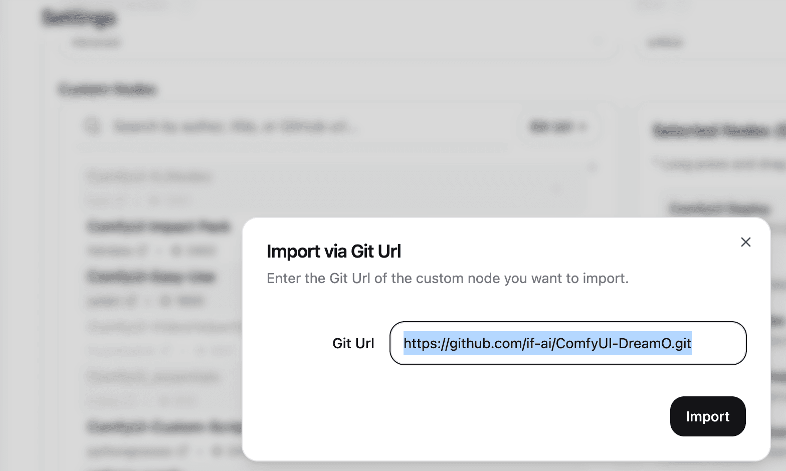
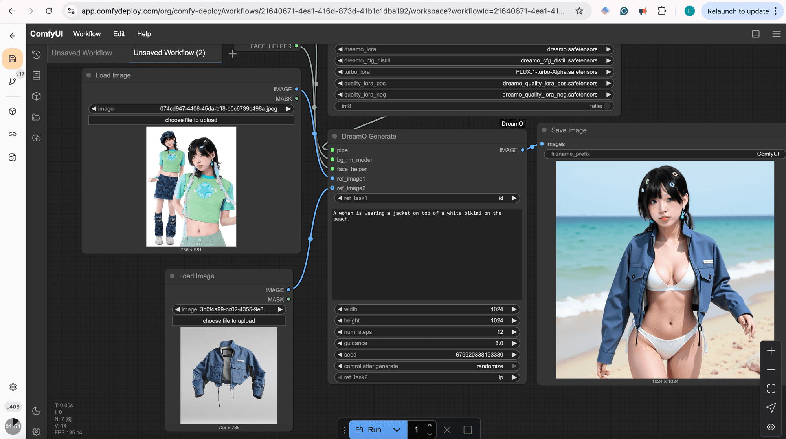
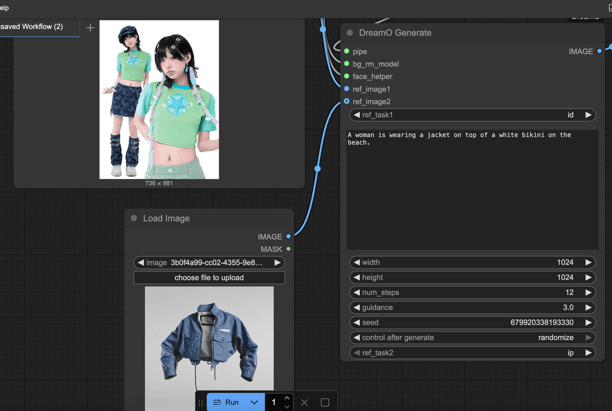
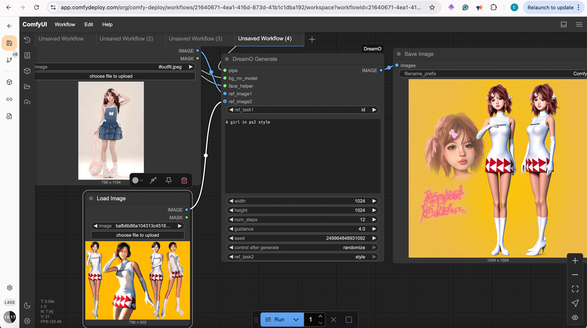
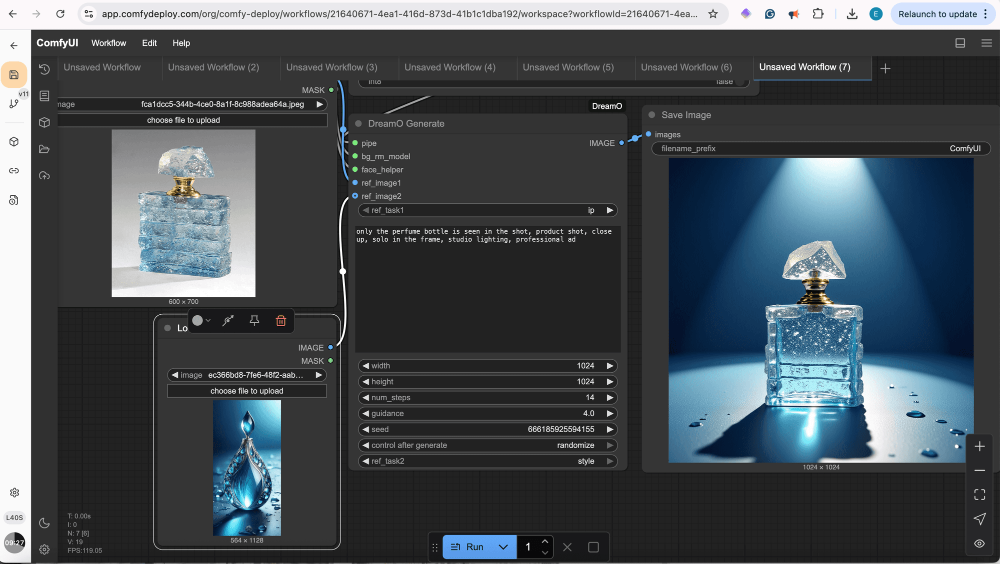

Creating consistent characters, performing virtual try-ons, seamlessly integrating objects into new scenes, or transferring artistic styles used to involve complex workflows and multiple tools. But what if you could do all that – and more – with a single, powerful framework?

Enter **DreamO**, a groundbreaking unified framework for image customization developed by ByteDance. And now, thanks to the ComfyUI community and a specialized fork, you can harness its power directly within your ComfyDeploy workflows!

**Watch Impact Frames explore DreamO in ComfyUI on ComfyDeploy:**

## What is DreamO?

DreamO ingeniously combines the capabilities of several cutting-edge AI techniques into one cohesive model:

- **IP-Adapter:** For transferring features from reference images (like clothing, objects, or general appearance) onto a new generation.
- **PullID:** To robustly preserve facial identity across different scenes and styles, ensure your characters remain consistent.
- **Style Transfer:** For applying the artistic or aesthetic style of one image to another.

This unification means you can achieve complex image manipulations that previously required juggling multiple models and intricate node setups, all through a more streamlined process.

## Why DreamO is a Game-Changer for Image Generation

The ability to combine these techniques opens up a vast array of creative and practical applications:

- **Consistent Characters:** Generate the same character in different outfits, poses, and environments while maintaining their core identity.
- **Virtual Try-On:** See how clothing items look on a specific person or character.
- **Product Placement & Object Integration:** Seamlessly place products or objects from one image into entirely new scenes or onto different characters.
- **Face Replacement/Swapping:** Accurately transfer a face from a source to a target image.
- **Advanced Style Transfer:** Apply complex artistic styles while retaining control over content and identity.

## DreamO in ComfyUI: The IF-AI Fork for ComfyDeploy

While the original DreamO has an official ComfyUI custom node implementation by JAX-explorer, for optimal use on ComfyDeploy and some added enhancements, we recommend the **IF-AI fork**.

**IF-AI ComfyUI-DreamO Fork:** [https://github.com/if-ai/ComfyUI-DreamO](https://github.com/if-ai/ComfyUI-DreamO)

This fork includes:

- Fixes and optimizations for smooth operation on ComfyDeploy.
- **Quality LORAs:** These help to reduce the "plastic look" sometimes seen in AI generations and improve overall image quality.
- Integration of Turbo LORAs for faster generation speeds.

## Setting Up DreamO on ComfyDeploy

Getting DreamO running on your ComfyDeploy machine is straightforward:

1. Go to your machine's "Environment" settings on ComfyDeploy.
2. Under "Custom Nodes," click the "+ Git Url" button.
3. Paste the URL for the IF-AI DreamO fork: https://github.com/if-ai/ComfyUI-DreamO.git
4. Click "Import." ComfyDeploy will handle the installation.

    
5. Save your machine configuration and launch a new deployment. The DreamO nodes will be available!

press git+ to add the custom-node

## Core DreamO Nodes and Workflow

The basic DreamO workflow in ComfyUI typically involves these key nodes:

1. **DreamO Load Model From Local:** Loads the main DreamO pipeline and allows you to specify paths for various components, including the enhancement LORAs from the IF-AI fork (like dreamo\_quality\_lora\_pos and FLUX.1-turbo-Alpha.safetensors).
2. **Load Image (x2):** For your ref\_image1 (primary subject/identity) and ref\_image2 (secondary subject/style/object).
3. **DreamO Generate:** This is the heart of the operation. It takes:
4. Pipe: From the Load Model node.
    - bg\_rm\_model, face\_helper: For background removal and face processing.
    - ref\_image1: Your first reference image.
    - ref\_task1: Specifies how ref\_image1 is used. Options:
    - Id: Focuses on facial identity (PullID).
        - IP: Focuses on object/clothing transfer (IP-Adapter).
        - Style: Focuses on aesthetic style transfer.
    - ref\_image2: Your second reference image (optional).
    - ref\_task2: Specifies how ref\_image2 is used (if provided). Options: ip, style.
    - Your text prompt.
    - Standard generation parameters (width, height, steps, guidance, seed).
5. **Save Image:** To view your masterpiece!

DreamO workflow in ComfyUI

## DreamO in Action: Example Scenarios

Let's look at how these settings translate into incredible results, as demonstrated in the video:

**1\. Character Identity + Virtual Try-On**

- **Goal:** Take a character and put them in a new outfit and scene.
- **Setup:**
- ref\_image1: Full shot of the original character.
    - ref\_task1: id (to keep the face)
    - ref\_image2: Image of the desired outfit (e.g., a denim jacket).
    - ref\_task2: ip (to transfer the coat)
    - Prompt: Describe the new scene and overall look (e.g., "A woman is wearing a jacket on top of a white bikini on the beach.")
- **Result:** The original character's face is preserved, and the new outfit is worn in the described scene.

**2\. Character Identity + Style Transfer**

- **Goal:** Transform a character into a specific artistic style (e.g., PS2 game graphics).
- **Setup:**
- ref\_image1: Image of the character.
    - ref\_task1: id
    - ref\_image2: Image representing the target style (e.g., a PS2 game character).
    - ref\_task2: style
    - Prompt: "A girl in PS2 style."
- **Result:** The character is redrawn in the PS2 aesthetic while retaining their facial identity.

Style transfer

**3\. Object/Product + Style Transfer (Product Shot)**

- **Goal:** Take an object (like a perfume bottle) and render it in a new, highly stylized way.
- **Setup:**
- ref\_image1: Image of the product (perfume bottle).
    - ref\_task1: style (or ip if you want strong object retention initially)
    - ref\_image2 (Optional): Image of a character or scene whose style you want to apply (e.g., Ulala from Space Channel 5).
    - ref\_task2: style
    - Prompt: "generate a same style image. Only the perfume bottle is seen in the shot, product shot, close up, solo in the frame, studio lighting, professional ad." (Note: The "generate a same style image" prefix is often helpful for style tasks).
- **Result:** A professional-looking, stylized product shot of the perfume bottle.

perfume bottle style

**4\. Combining Multiple Identities/Objects**

- **Goal:** Place a character alongside another distinct element, preserving both.
- **Setup:**
- ref\_image1: Image of the main character.
    - ref\_task1: id
    - ref\_image2: Image of the second element (e.g., a panda).
    - ref\_task2: id (or ip if it's more object-like)
    - Prompt: "A girl walks along a panda..."
- **Result:** Both the girl and the panda appear in the scene, each with their identity preserved.

## Tips for Best Results

- **Turbo LORA:** For faster iterations, enable the FLUX.1-turbo-Alpha.safetensors in the "DreamO Load Model" node and reduce num\_steps (e.g., to 12).
- **Quality LORAs:** Use dreamo\_quality\_lora\_pos and dreamo\_quality\_lora\_neg to combat the "plastic look" and enhance details.
- **Guidance Scale:** If images appear too glossy or "plastic-y," especially with ID tasks, try lowering the guidance scale (e.g., 3.0-4.0).
- **Prompting for Style:** When using the style task, sometimes prefixing your prompt with "generate the same style" can improve adherence to the reference style.
- **Experiment!** The magic of DreamO is its versatility. Don't be afraid to mix and match ref\_task settings and play with prompts.

## Conclusion

DreamO represents a significant leap forward in AI image customization, offering a unified and powerful way to control identity, objects, and style. With the IF-AI fork, running these sophisticated workflows on ComfyDeploy is more accessible and efficient than ever. Whether creating art, designing virtual fashion, or conceptualizing product visuals, DreamO provides an incredible toolkit to bring your visions to life.

**Ready to try it yourself?**

- **IF-AI ComfyUI-DreamO (for ComfyDeploy & local with enhancements):** [https://github.com/if-ai/ComfyUI-DreamO](https://github.com/if-ai/ComfyUI-DreamO)
- **Run on ComfyDeploy:** [https://www.comfydeploy.com](https://www.comfydeploy.com)
- **Original DreamO Project (ByteDance):** [https://github.com/bytedance/DreamO](https://github.com/bytedance/DreamO)
- **Official DreamO Hugging Face Demo:** [https://huggingface.co/spaces/ByteDance/DreamO](https://huggingface.co/spaces/ByteDance/DreamO)
- **JAX-explorer ComfyUI-DreamO (Original Custom Node):** [https://github.com/jax-explorer/ComfyUI-DreamO](https://github.com/jax-explorer/ComfyUI-DreamO)

We can't wait to see what you create!
