Whenever you need to position an object in the frame or modify an image element, inpainting is an essential technique to master.

Start by bringing in the image we want to manipulate. I have an idea of placing a polar bear in the middle of the desert, holding a Coca-Cola bottle.

Impainting in ComfyUI needs some exploration and trial and error. Using tools like ControlNet and Redux together can make it easier later.

Let's begin our experimentation.

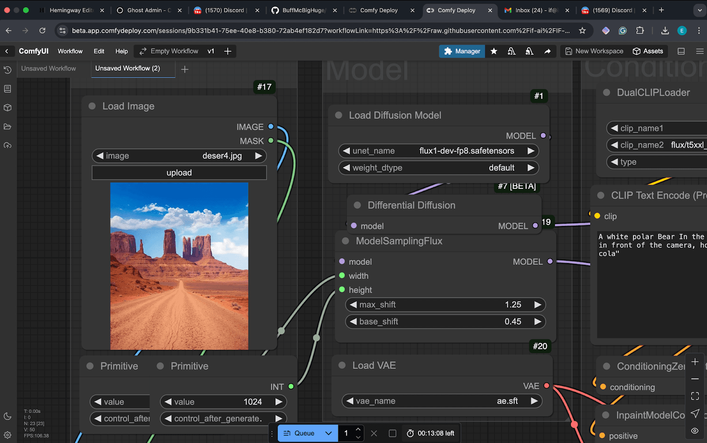

Right-click on the image and open the mask editor. Now, you can paint a mask using the brush tool. We only need a rough shape of the bear.

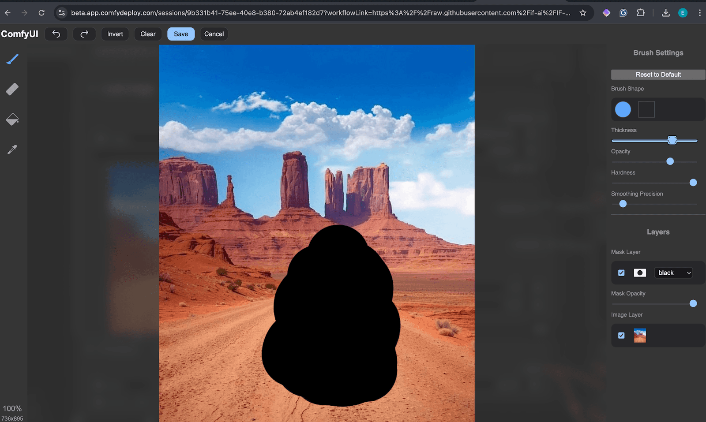

I use the following prompt:

> _A anthropomorphic realistic photo white polar Bear In the middle of the desert standing on it's hind legs in front of the camera, holding a "coke-cola" bottle_

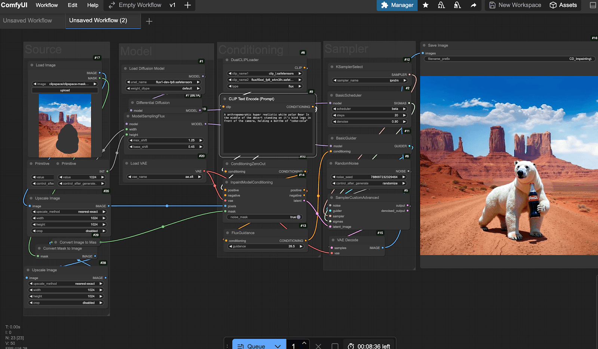

My rough mask and text prompt combination didn't work as I expected. It places the bear on four legs. But I wish for a human pose.

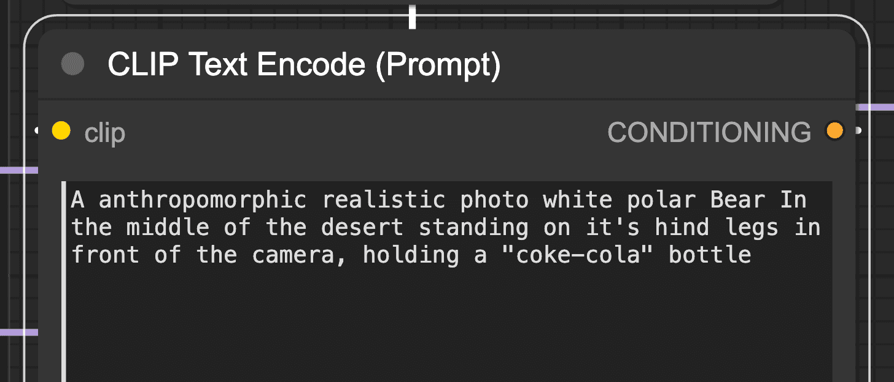

I tweaked my prompt, added "standing on its hind legs," and stretched the mask to match the silhouette of a polar bear.

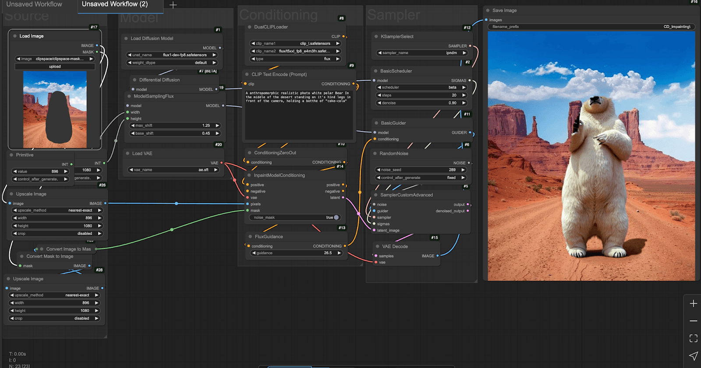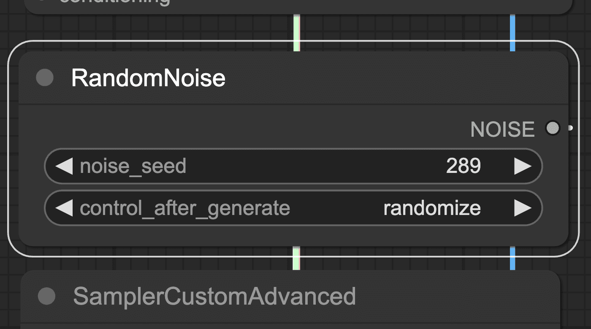

Now, the shape is better, but my mask needs more work. I tried a different seed near the one selected, and now the bear is more like what I want.

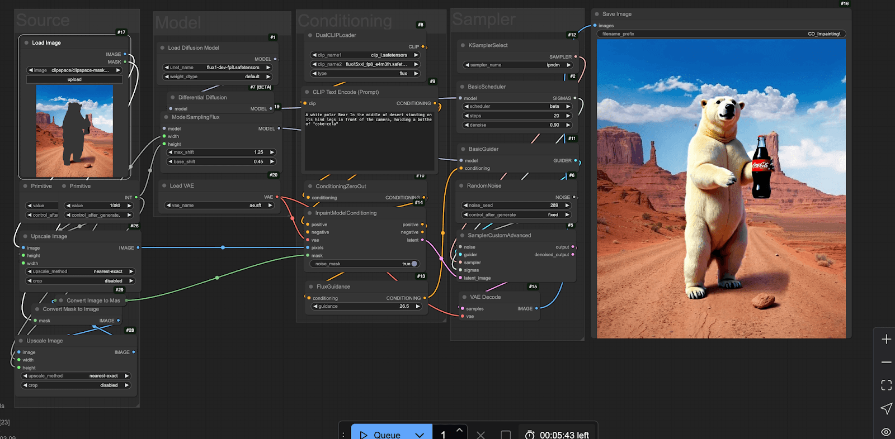

The bear is missing part of its hand and head. Let's use inpainting again to improve it. I opened it in the mask editor. Then, I used a finer brush around the edges, filled in the shape, and regenerated it with the same settings.

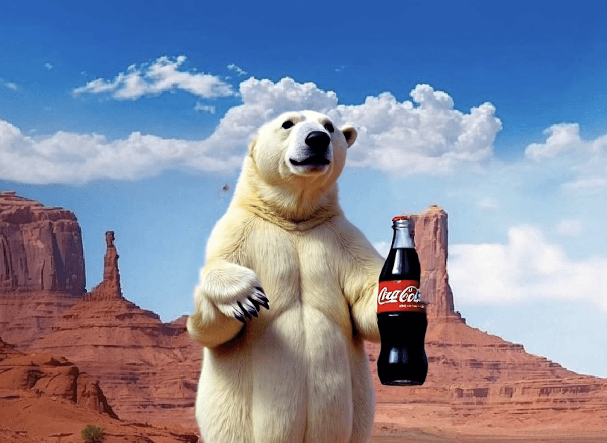

Now our bear is looking much better! I then rerun the image through our workflow, but instead of inpainting it, we do an image-to-image. With in the basic scheduler node, we select a small denoise value of 0.9

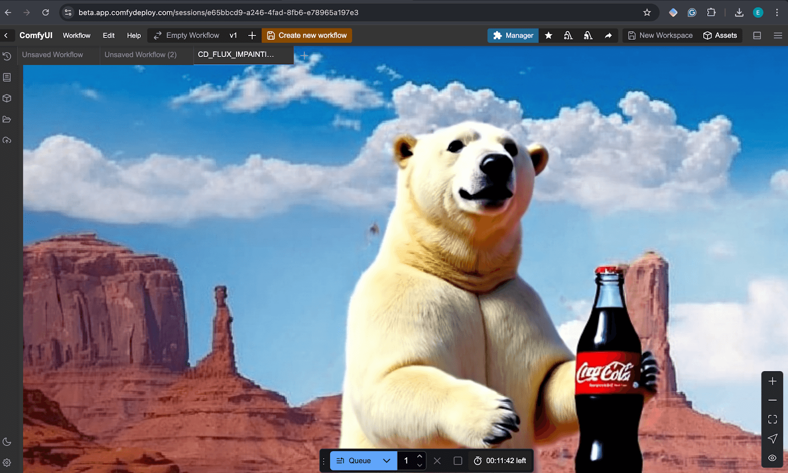

Now, we chain a "load upscale model" node and an upscale image using model nodes from the VAE decode Image output. And generate the final image for this test.

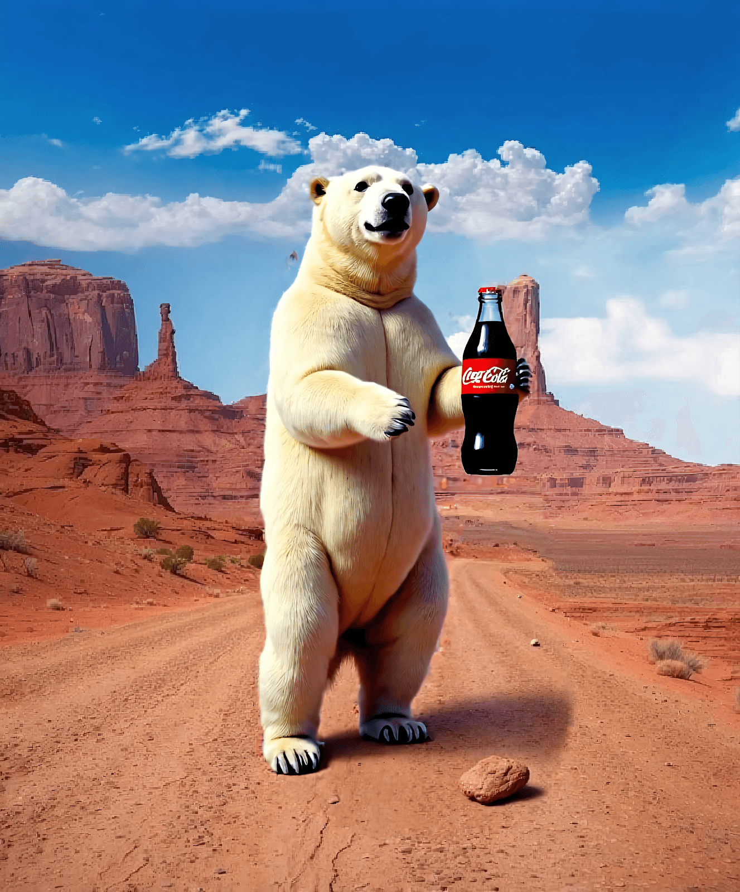

You can save this to your computer and drag it into comfyui to open the workflow

## Fundamental Nodes For Inpainting

The key nodes for this workflow are the _InpaintModelConditioning_ node and the _DifferentialDiffusion_ node.

The differential diffusion nodes help maintain the images' details and integrity during the latest sampling steps. Meanwhile, the impainting node drives the conditioning and helps integrate the noise generated into the base image.

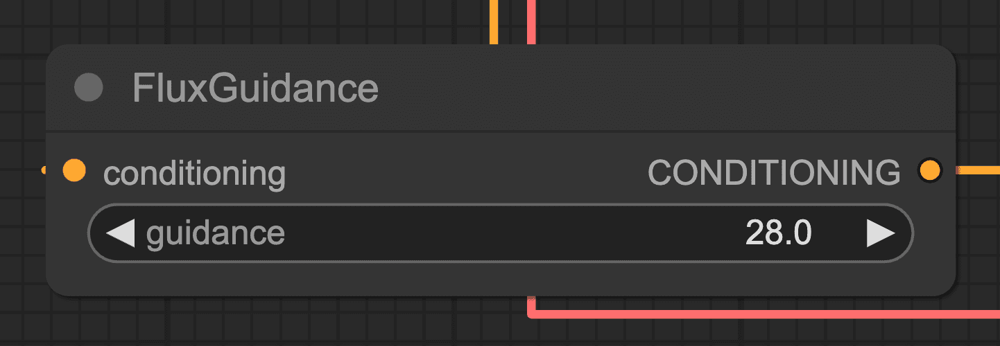

Strong guidance is needed to make the generation follow the prompt more aggressively.

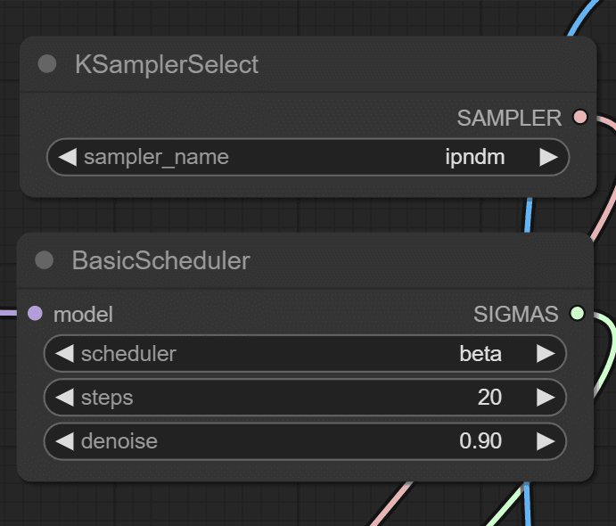

The **ipndm** sampler is a good choice because it is quick and deterministic. It can help with iterating tasks by keeping the outputs reproducible. We can move within the same seed and have similar results as we experiment or fix the drawings.

Finally, another critical component is leaving some leftover noise by selecting 0.90. This balances the current image details with the new generation in the masked area. If we apply all the denoising steps, the model may create artifacts and allow more room for errors.

## Tips

It Is important to note that this technique requires iteration; good results often need more than one or two passes.

It's not effective to chase finer details with just raw inpainting. For better results, mix in techniques like control net and redux.

The mask works best with broader strokes and is dependent on resolution. It is better to work with broader shapes than refined outlines.

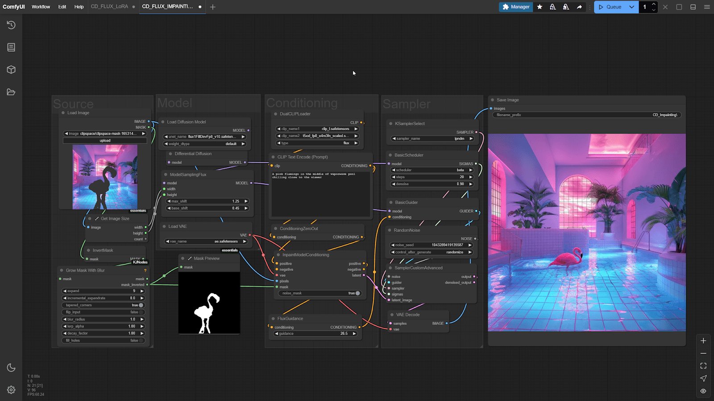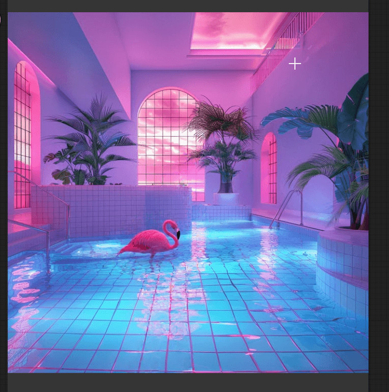

You can combine Loras to paint your character by merging a model with Flux.

Also, Flux Fill is a special inpainting version of Flux that is also available.

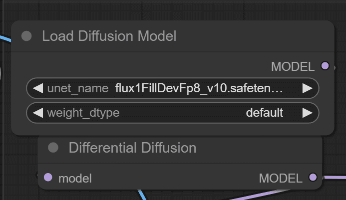

Use it to explore concepts. Adjusting denoise to 75% generates interesting outputs.

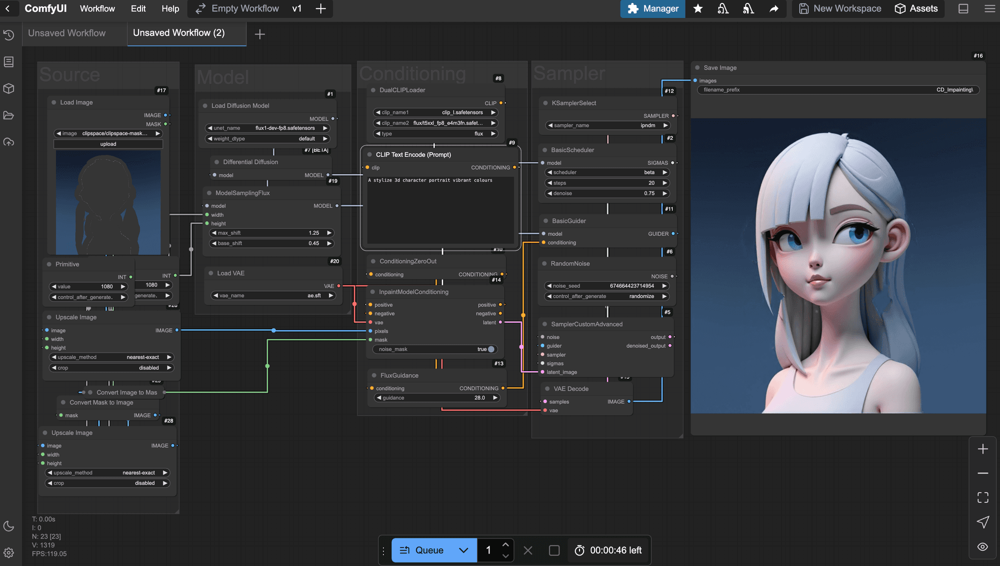

Read more about the Flux ControlNet and Redux techniques.

## Conclusion

Inpainting creates captivating compositions easily. It also helps fix images and place objects. While it takes effort, the results can be very rewarding.
