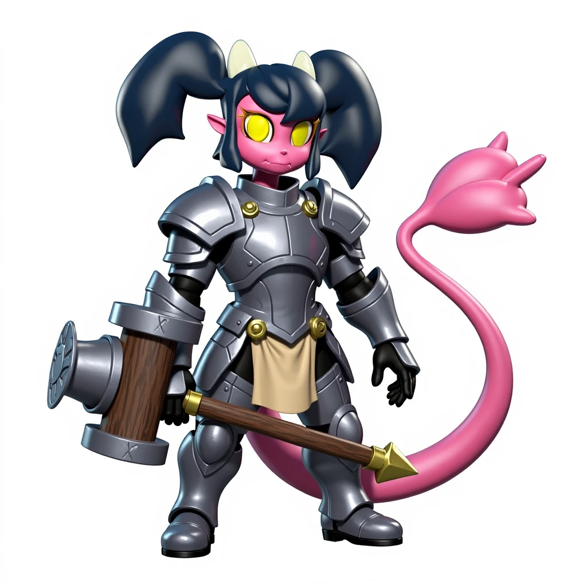

FLUX.1 Kontext Dev is an image editing model from Black Forest Labs. It takes text and images as input and edits an image based on what is already in it, while keeping characters and composition stable across several edits.

## What is FLUX.1 Kontext Dev?

FLUX.1 Kontext Dev is built on a 12 billion parameter diffusion transformer. It accepts text and image inputs together, so you can describe a change in plain language and the model applies it to the image you provide.

The model combines context understanding with precise editing. Characters and composition stay consistent over multiple iterative edits, and generation remains fast. Black Forest Labs describes the full details in the [official announcement](https://bfl.ai/announcements/flux-1-kontext-dev).

## Key features of FLUX.1 Kontext Dev

- **Character consistency.** Unique elements, such as a reference character or object, are preserved across scenes and environments.
- **Targeted editing.** You can change specific elements of an image without affecting the rest.
- **Style reference.** The model generates new scenes from a text prompt while keeping the style of the reference image.
- **Interactive speed.** Generation and editing run with low latency.

## Flux Kontext Dev ComfyUI workflow

These two ComfyUI workflows edit images with Flux Kontext Dev. Open either one to see the nodes, run it, or fork it into your own project.

### Nunchaku: edit two images faster

The [FLUX.1 Kontext Dev (Nunchaku) workflow](/workflows/faster-kontextdev-edit-two-images-with-nunchaku) edits two images together using a Nunchaku-quantized model for faster generation.

### NAG: combine two characters

The [FLUX.1 Kontext Dev (NAG) workflow](/workflows/kontextdev-edit-with-two-images-with-nag) combines two characters using NAG (Normalized Attention Guidance). You can run it repeatedly to preserve character traits and context across editing rounds.

## FLUX.1 Kontext Dev vs Qwen Image Edit

Qwen Image Edit is another leading open image editing model. The table summarizes how the two differ. For a full overview of Qwen's model, read our [Qwen Image Edit guide](/blog/qwen-image-edit).

| Feature | FLUX.1 Kontext Dev | Qwen Image Edit |
| --- | --- | --- |
| Model size | 12B parameters (dev), plus Pro and Max variants | 20B parameters |
| Editing approach | In-context generation with multimodal flow | Semantic and appearance editing with VAE control |
| Text editing | Advanced typography generation | Bilingual (Chinese and English) with font preservation |
| Speed | Up to 8x faster than competing models, per Black Forest Labs | Standard inference time |
| Iterative editing | Multi-turn editing with consistency | Single-pass editing |
| Character consistency | Cross-scene character and style consistency | Strong identity preservation |

## Which model should you choose?

**Choose FLUX.1 Kontext Dev for rapid iteration.** It suits creative experimentation where you want quick results and multi-turn edits that keep a character consistent. Artists, developers, and creative teams who work in iterative loops will benefit most.

**Choose Qwen Image Edit for precise control.** It fits professional workflows that need exact element changes, bilingual text editing, and detailed control over image elements. Graphic designers, content creators, and businesses that need accurate edits will get the most from it.

Both models have different strengths, so it is worth running the same prompt through each to see which fits your workflow.
