At first, I struggled to create the image above using only Flux. However, after adding a [Sabrina Carpenter](https://civitai.com/models/882980/sabrina-carpenter-flux) Lora from Civitai, I could generate an image with a likeness. Right here lies the power of LoRAs.

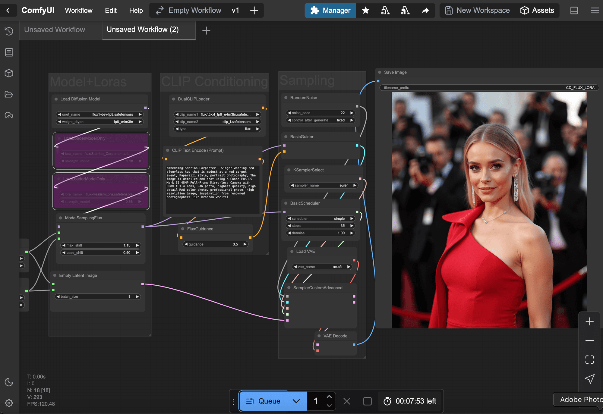

_The original model does not contain Sabrina Carpenter therefore the generation_ is disappointing

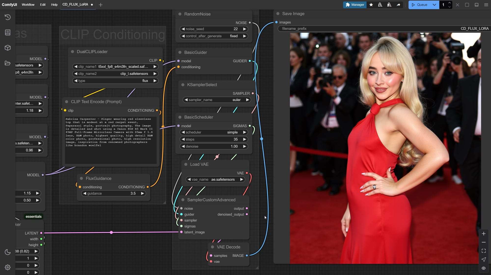

[Sabrina Carpenter - Flux | Singer / Celebrity - v1.0 | Flux LoRA | Civitai](https://civitai.com/models/1231940/sabrina-carpenter-flux-or-singer-celebrity)
By overlaying a LoRA, I found on Civitai, Bang! we are on the money. I can reproduce the concept accurately.

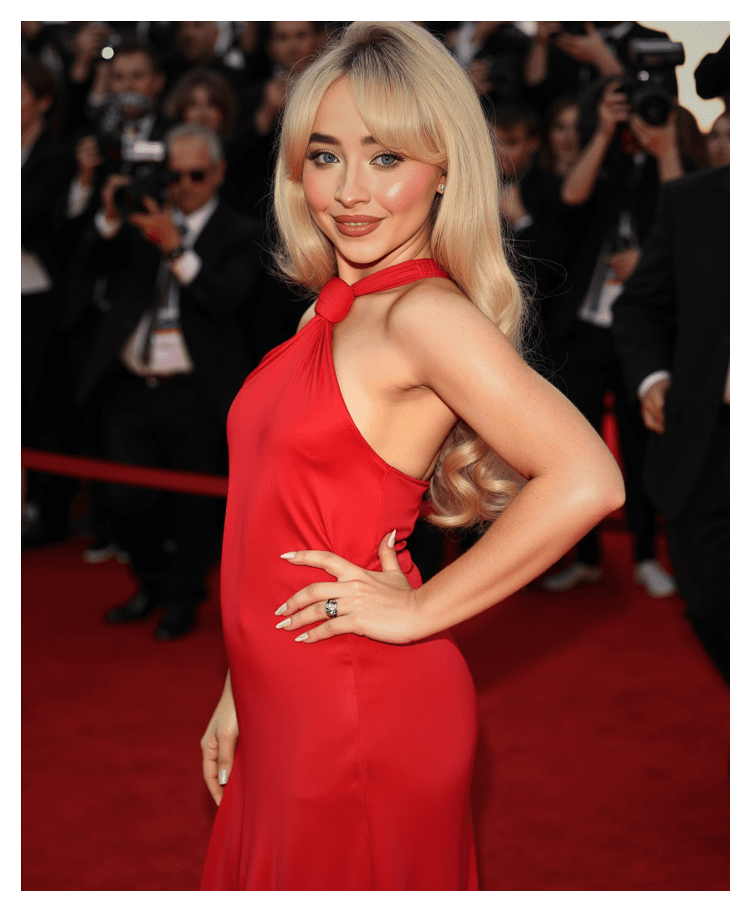

I added A Lora and layer a realism lora to help with the details

With Loras, we can overcome the fact that stable diffusion models can only generate images based on the concepts they were trained on.

A LoRA is a small portable file that you can use with a base model like FLUX Dev/Schnell/Pro to improve the outputs. Think of it as a small extension you add to the base model to extend its capabilities.

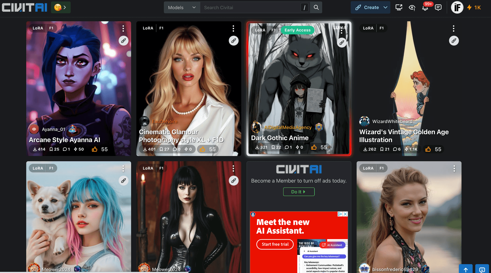

Civitai offers a wide range of models to chose

You can find free community-made models on CivitAI and HuggingFace. You can download these models to use them in your ComfyUI workflows.

> We will look into training your own models in a future article. It's fast to train and convenient to use.

You can add model to your storage automatically directly from Civitai or HF by searching their name

## Control

You can chain multiple loras together. Then, tweak the weight values using the &lt;strength\_model> slider. This way, you can make one concept stronger than the others.

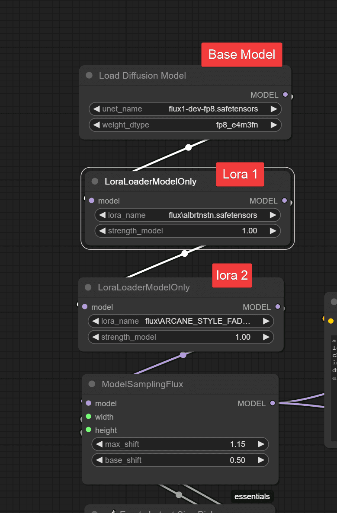

It's pretty simple to chain loras

Some loras may have unique recommended settings. This can occur if the model is over-trained or under-trained. This slider helps create a better balance with the base.

Stable Diffusion Models link concepts to images through text embeddings. You can influence the generation by adding a "Trigger Word" to your prompt. Each Lora model has their own keywords that trigger the concept.

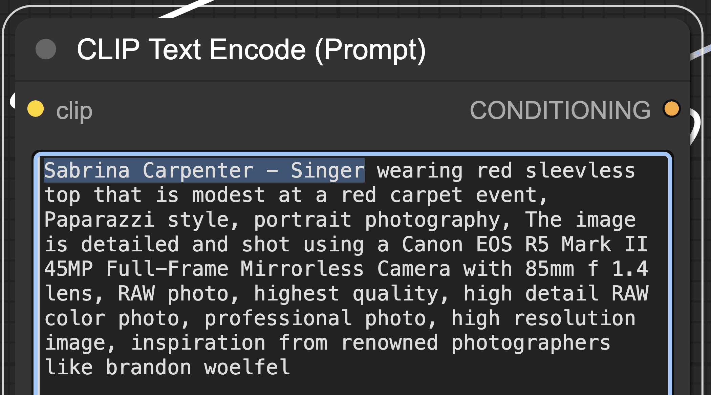

In this case the trigger word is "Sabrina Carpenter - Singer"

A neat trick to give more strength to your concept is to repeat the trigger word on the text prompt or use word weighting

Writing "embedding:trigger\_word" and highlight it. Then, pressing ctrl + up or down, you can increase or decrease the weights. This will automatically add numbers up and down to increase or decrease the strength.

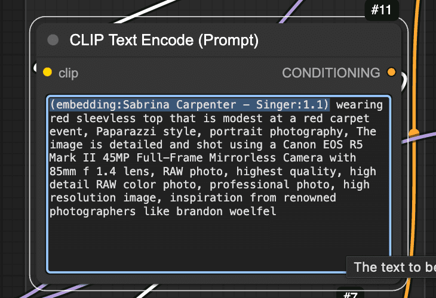

I made these with loras too

## Flux LoRA Types

_**Concept**_: This is the most common model. The aim is to replicate a concept not included in the model's base training. This can be an object, a person, an environment, or a costume. You can choose any prop for set design. Each can be carefully crafted based on your project’s needs.

_**Style**_: This allows artists to mimic their style. They can train it easily to assist in their artistic process. It also helps to maintain a consistent art direction over a longer project.

**Generation Distill**: These Loras cut down the steps and are used for fast generation

_**ControlNet**_: Control Loras can change how an image is conditioned. We can obtain either a depth map or a canny map from an image using a depth or canny pre-processor.

## Test Cases

We can still boost the output even when the model understands the concept. For example, we achieved good results with Albert Einstein right from the start since the model included him in its original training.

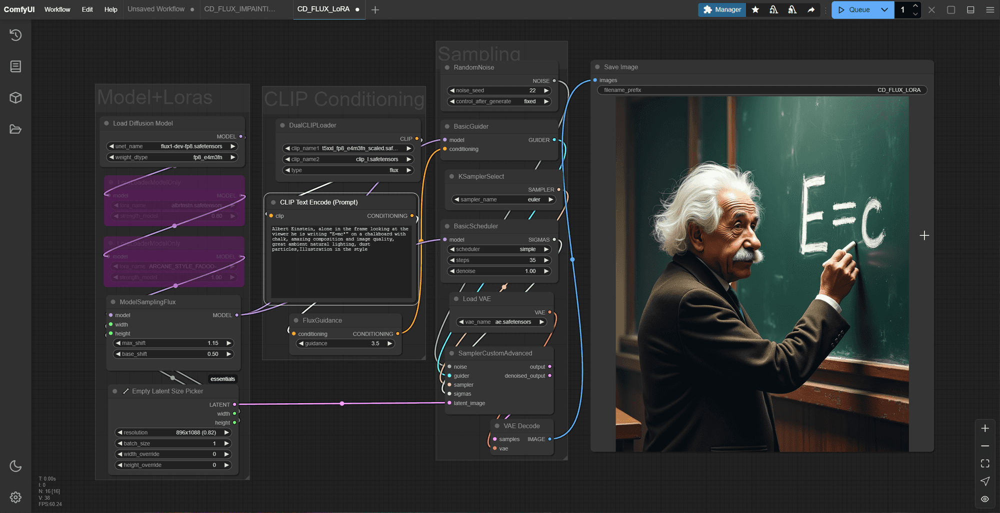

The concept already exist on the base training

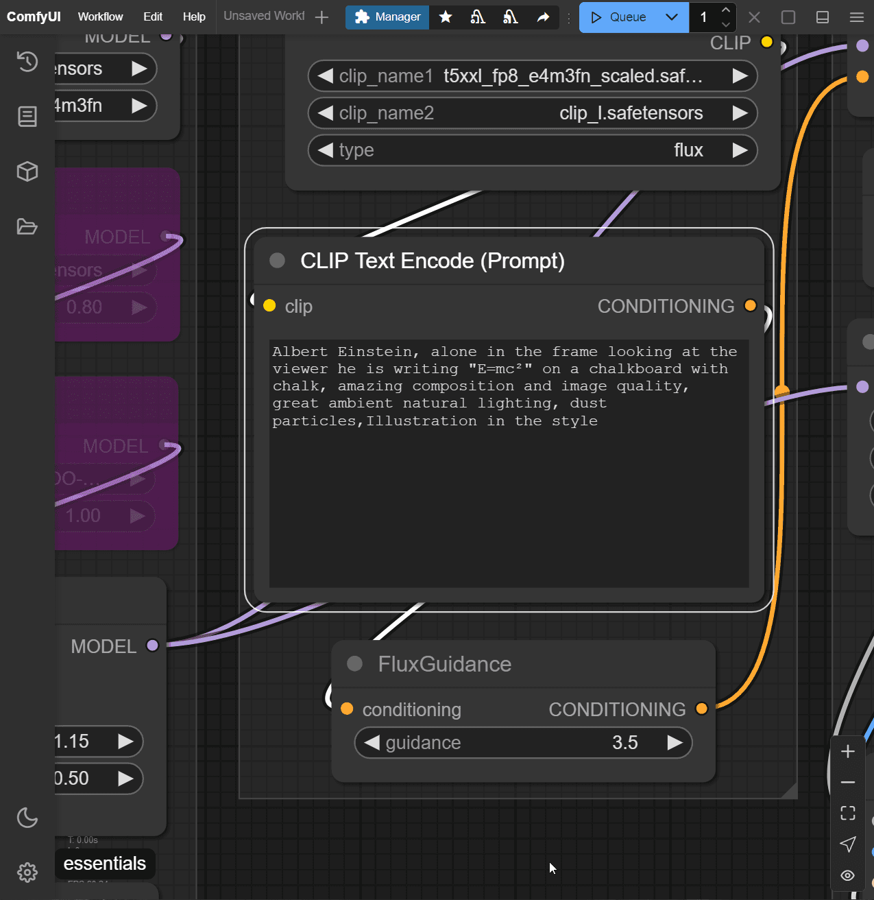

the raw prompt is not enough for the requirements

We want to add more detail and use a hand-painted style. In that case, we could use a Lora trained on the concept. Then, we can pair it with another Lora and overlay a style effect. This approach will make it much more compelling.

[Albert Einstein - FLUX LoRA - v1.0 | Flux LoRA | Civitai](https://civitai.com/models/816243/albert-einstein-flux-lora)
[Arcane Style \[LORA\] \[Fadoo Flux\] - v1.0 | Flux LoRA | CivitaiDon’t forget to support! Please help upgrade or expand with more LoRAs, by giving likes, and posting your own images ♥ Your support fuels this lora…Civitai](https://civitai.com/models/838134/arcane-style-lora-fadoo-flux)

With LoRAs you can combine Characters, Styles, Locations and much more

Now, even the equation is correct.

Finally, a more dramatic change can be seen with Lora models that target aesthetics, as the range of illustration is narrower than the original base.

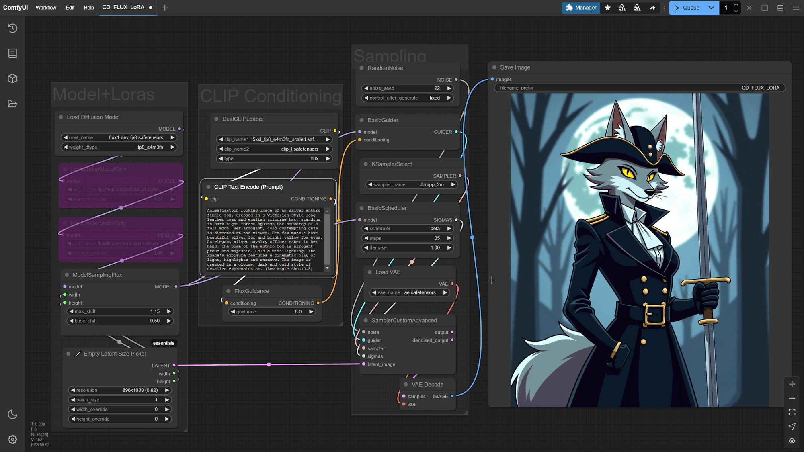

Here is a prompt on the base flux for this fantasy character. We can see the output is a bit dull.

[Fantasy world - Greg Rutkowski | Flux LoRA | Civitai](https://civitai.com/models/974790?modelVersionId=1433936)
[Fantasy world - Greg Rutkowski | Flux LoRA | Civitai](https://civitai.com/models/974790?modelVersionId=1433936)
With a good aesthetic Lora addition, the result is way superior.

Layering those two will give you a good result. You can drag this image into the ComfyDeploy workflow I shared at the beginning of the article above

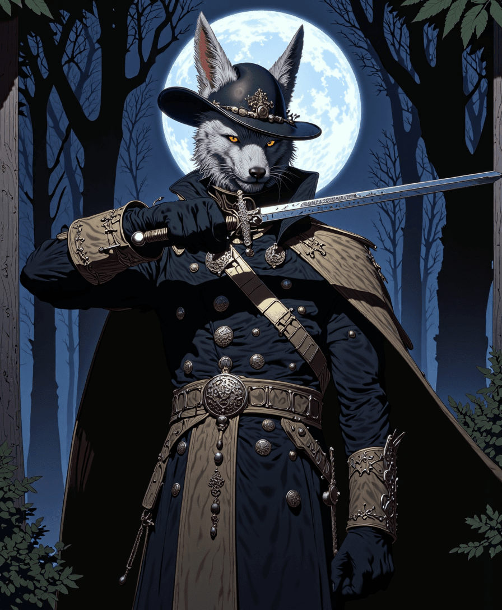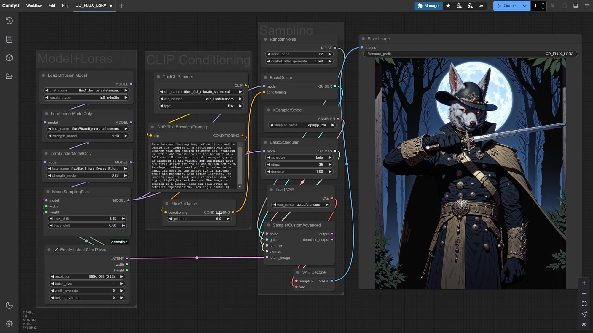

## Tips

Some LoRAs are over-trained or under-trained. They need lower values to work well.

Use Loras on a 2 stack (character/style) (environment/details-effect), carefully mixing effects with a concept Lora.

For realism, find special loras that add skin details, hand fixes, eye fixes, and layering post effects.

We can use regional conditioning and advanced masking to manage each Lora's effects. We'll discuss this more in a later post. Let's focus on getting familiar with Loras and how to use them in our workflows.

## Conclusion

A Lora is a small extension file we can add to our base model to produce better images. It often includes trigger words and captions. You can use these captions to activate the weights.

You can use loras for Styles, Persons, Objects, details, and environments, control the image drawing, and even improve the generation speeds.

LORAs are an easy way to improve your outputs. They help achieve consistency, improve quality, and are easy and cheap to produce and use. They are essential to keep art direction constraints and can be a way to separate your art from the crowd. You can train your own art style, your characters and have your own artistic flair. You can train your own art style and characters and have artistic flair.
