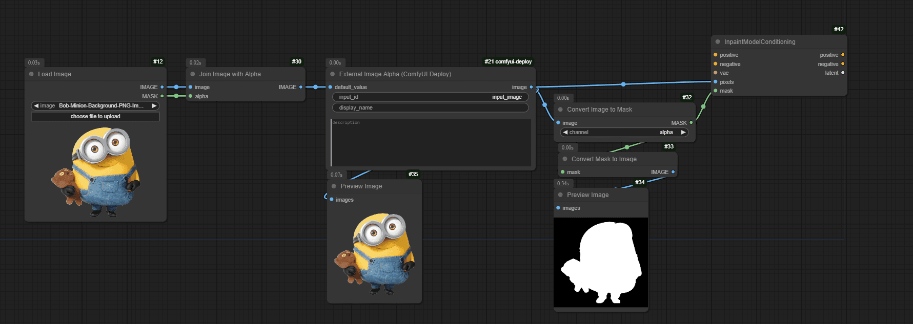
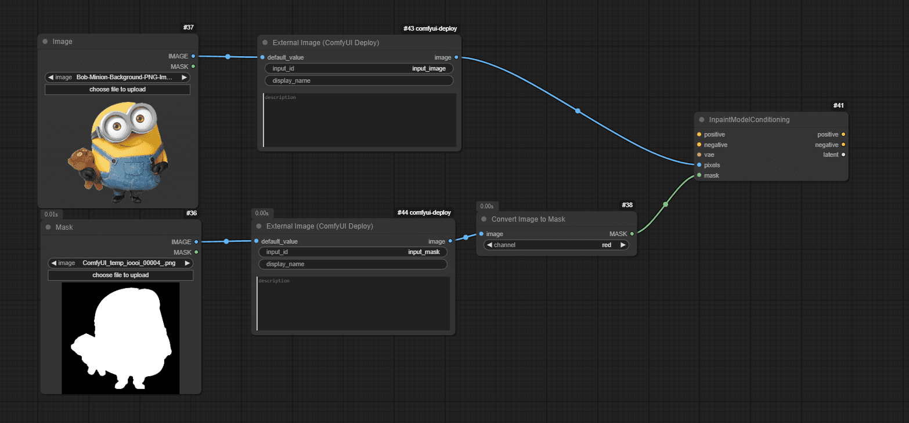

If you're familiar with ComfyUI, you've probably used the load image node to create masks for your workflows. However, when transitioning to Comfy Deploy, things work a bit differently because we need to support the usage of the workflows in your applications via API calls.

Thanks to external image custom nodes, we can achieve the same masking capabilities with even more flexibility. In this post, we'll explore two powerful methods to implement masks in your Comfy Deploy workflows, complete with practical examples that you can start using right away.

## What are the 2 Different Use Cases?

1. Using PNG Alpha Channel as a Mask
- In this approach, you send a single PNG file that contains both your image and the mask information within its alpha channel.
    - The transparency data embedded in your PNG serves as your mask.
    - This method is more efficient as it requires sending only one.
    - Perfect for cases where you're working with pre-prepared images, like product photos with transparent backgrounds.
2. Sending Separate Image and Mask
- This method involves sending two distinct files: your base image and a separate mask image.
    - The mask image defines which areas of your base image should be affected.
    - While it requires sending two files, this approach is more straightforward and easier to understand.
    - Ideal for scenarios where you need to dynamically generate or modify masks.

While both approaches are equally valid, the second method tends to be more intuitive, especially when you're just getting started with masking in Comfy Deploy. However, the PNG alpha channel method offers the advantage of reduced payload size since you're only transmitting a single file. The choice between these methods often depends on your specific use case and workflow requirements.

## 1. Using PNG Alpha Channel as a Mask

in this example, you can see that I'm adding a `Load Image` and `Join Image with Alpha`, and this is because with those nodes and connecting them to the external image alpha, we ensure that we can develop the workflow easily (when you are using the workspace feature).

Make sure to use `External Image Alpha`, this custom node will load the image that you choose and output that image with the alpha channel. `External image` node won't output the alpha channel.

**NOTE:** In this case is creating the mask in the minion, but if you want to select the background you can use `invert mask` node

## 2. Sending Separate Image and Mask

This use case is easier in my opinion, we are specifying 2 inputs, where 1 will be the mask. And in this example, you only need to use the `Convert image to Mask`.

Remember that you can also use the `invert mask` node in case that you want to select the opposite.
