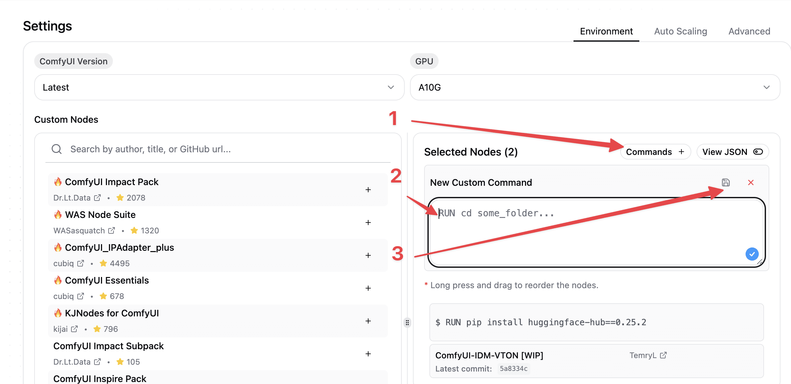

[GitHub - TemryL/ComfyUI-IDM-VTON](https://github.com/TemryL/ComfyUI-IDM-VTON/)

Installing these custom nodes is relatively straightforward, requiring just one modification, which is simple and manageable.

## TL;DR

**NOTE:** Keep in mind that the build process may take some time because the custom nodes download files from servers that appear to be slow. The download can take up to 25 minutes.

## What Problem Did We Encounter?

The nodes appear to install successfully, and no errors are displayed on the machine. However, when opening the workflow, the nodes are missing and appear as red rectangles.

## Why Does This Happen?

The custom nodes rely on the `cached_download` function, which was removed in version 0.26.0 of Huggingface-Hub. To resolve this, you need to downgrade the Huggingface-Hub dependency to version 0.25.2.

Reference: [https://github.com/easydiffusion/easydiffusion/issues/1851#issuecomment-2437615074](https://github.com/easydiffusion/easydiffusion/issues/1851#issuecomment-2437615074)

## Step 1: Add the Docker Command in Comfy Deploy

To add the Docker command in Comfy Deploy:

1. Navigate to the machine page. The URL will look like this: `https://app.comfydeploy.com/machines/3e81116b-5f06-47fa-9972-777202c79cce`. Replace the machine ID with your specific one.
2. In the **Selected Nodes** section, click on **Commands** and add the Docker command provided above.
3. Save the Docker command by clicking the save icon.



## Step 2: Adjust the Command Order

**Note:** Ensure the Docker command runs before the custom code. To reorder commands:

- Click and hold the row for the command.
- Drag and drop it to the correct position.

## Step 3: Start the Build Process

After making these changes, proceed with the build process. You can use the default settings.

These are the default versions at this point if you are curious about it:

- CUDA: `12.1`
- Torch: `2.5.1`
- Python: `3.11`

## About the Build Process

The machine build process will take a few minutes, as some models are downloaded during installation. Based on our tests, this step can take significant time. In some cases, it took up to 25 minutes to complete due to the size of the files being fetched.

Here is an example of what the console output might look like during this step:

```
For more details, check out https://huggingface.co/docs/huggingface_hub/main/en/guides/download#download-files-to-local-folder.
warnings.warn(

Fetching 30 files:   0%|          | 0/30 [00:00<?, ?it/s]
Fetching 30 files:  10%|█         | 3/30 [00:00<00:06,  3.90it/s]
Fetching 30 files:  13%|█▎        | 4/30 [00:00<00:06,  4.27it/s]
Fetching 30 files:  17%|█▋        | 5/30 [00:24<03:11,  7.66s/it]
Fetching 30 files:  20%|██        | 6/30 [00:25<02:13,  5.58s/it]
Fetching 30 files:  23%|██▎       | 7/30 [00:25<01:29,  3.89s/it]
Fetching 30 files:  30%|███       | 9/30 [04:03<18:31, 52.92s/it]
Fetching 30 files:  53%|█████▎    | 16/30 [04:28<04:16, 18

```

By following these steps, you’ll successfully install the ComfyUI-IDM-VTON custom nodes in Comfy Deploy.
