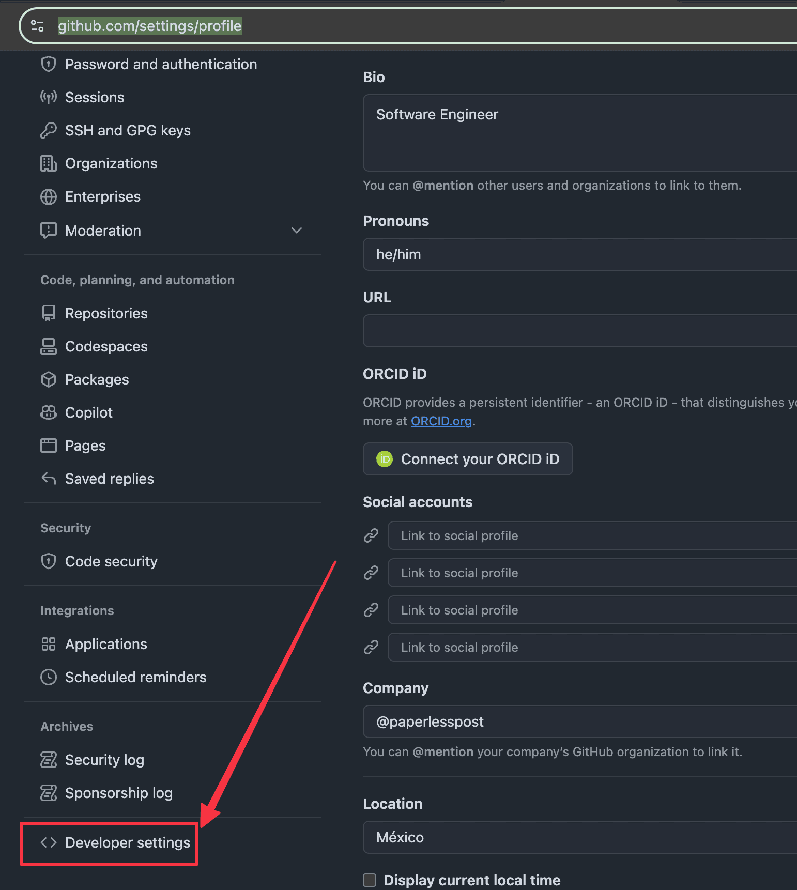
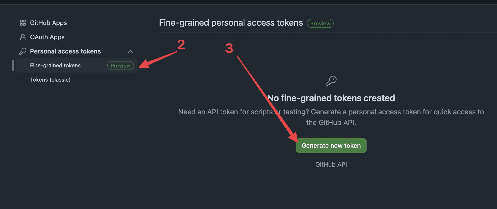
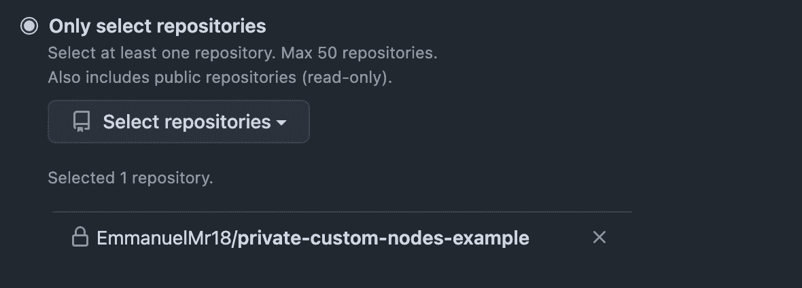
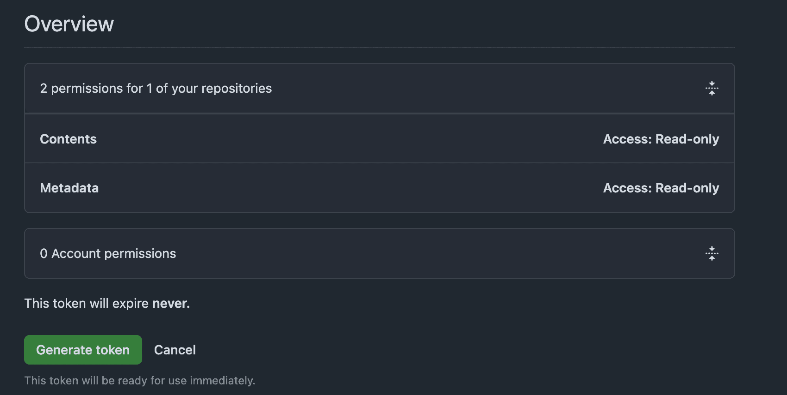
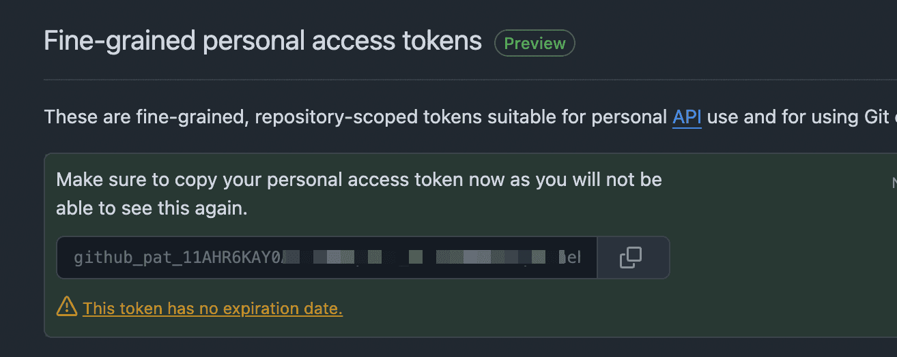
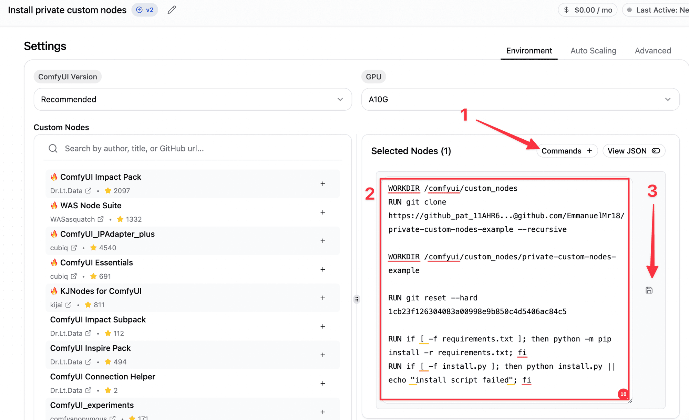
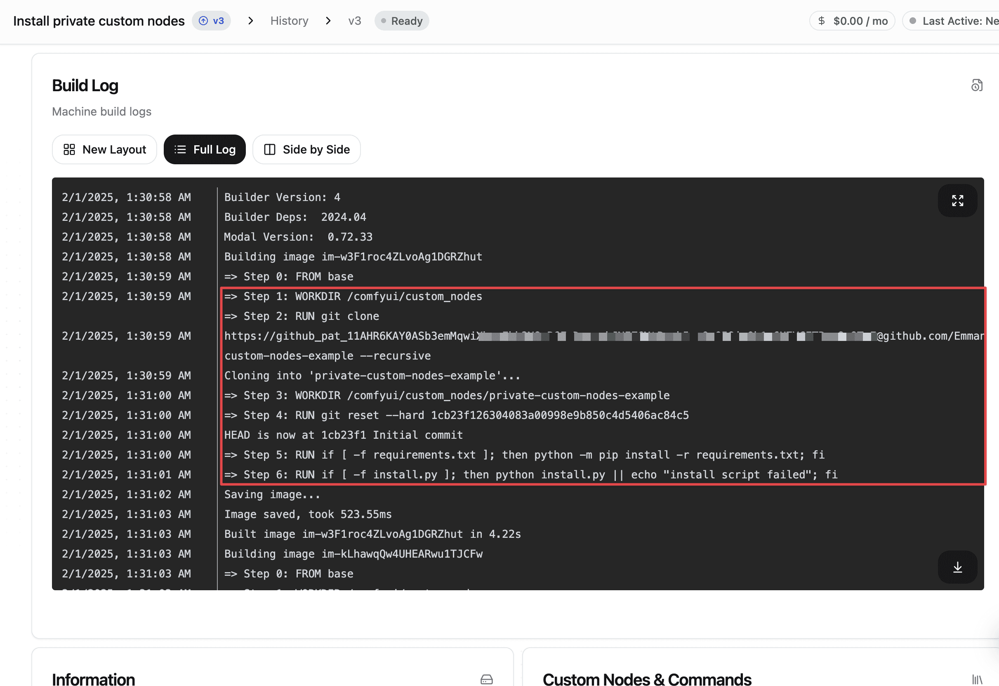
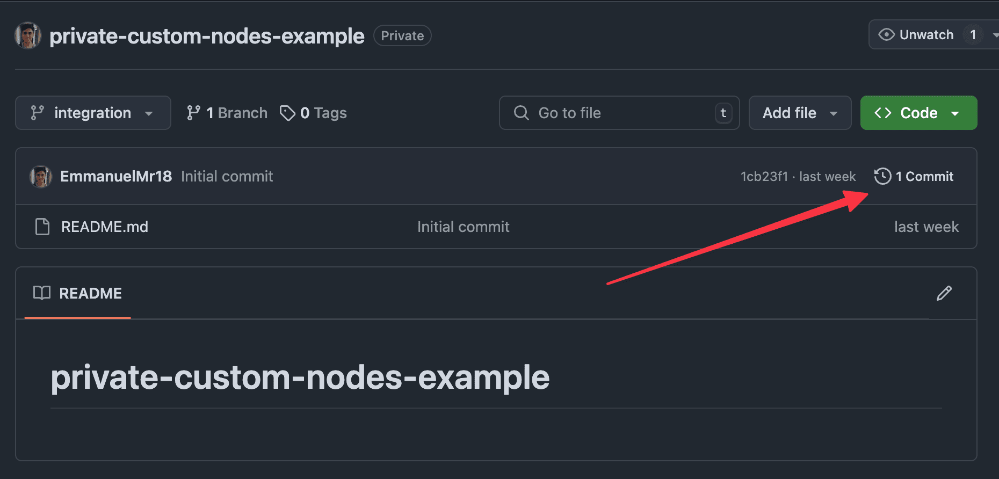
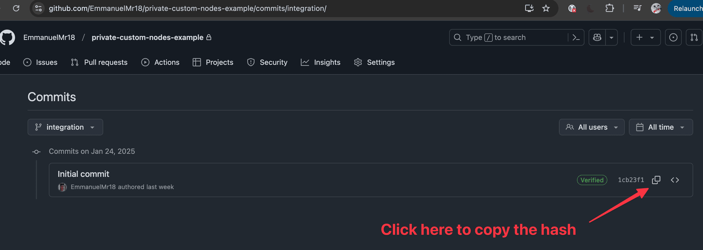

Sometimes, when dealing with complex or niche workflows, you might not find the custom nodes you need to complete your task. In such cases, one option is to create your own custom nodes and store them in a private repository.

This issue can also occur if you already have a perfectly functioning workflow that relies on several custom nodes which take a long time to load initially—thereby increasing your cold start time and overall execution cost. To optimize performance, you can build custom nodes that include only the components you require and explore ways to enhance their efficiency.

No matter your situation, in this guide we'll show you how to integrate these private custom nodes into your machines using Comfy Deploy.

## TL;DR

1. Create a Github Access Token
2. Add this custom command in your machine
3. Replace ACCESS\_TOKEN
    - Replace REPO\_NAME
    - Replace USER
    - Replace COMMIT\_HASH

```
WORKDIR /comfyui/custom_nodes
RUN git clone https://ACCESS_TOKEN@github.com/USER/REPO_NAME --recursive

WORKDIR /comfyui/custom_nodes/REPO_NAME

RUN git reset --hard COMMIT_HASH

RUN if [ -f requirements.txt ]; then python -m pip install -r requirements.txt; fi
RUN if [ -f install.py ]

```

## Create a Github Access Token

1. Go to your user settings and click in `Developer Settings`



2. I'll recommend you to create a Fine-grained token, so you only give the necessary permits.



3. Since we are just giving grained access, we can create the token with not expiration date. Just make sure to select the correct repository and next permissions:
4. Contents = read-only
    - Metadata = read-only



4. Now just copy your access token and save it, we'll use it in the next step



## Add your private custom commands in your machine

Now that we have the access token and the private repository, we need to create a custom docker command on your machine.

The custom docker command looks like the following:

```
WORKDIR /comfyui/custom_nodes
RUN git clone https://github_pat_11AHR6...@github.com/EmmanuelMr18/private-custom-nodes-example --recursive

WORKDIR /comfyui/custom_nodes/private-custom-nodes-example

RUN git reset --hard 1cb23f126304083a00998e9b850c4d5406ac84c5

RUN if [ -f requirements.txt ]; then python -m pip install -r requirements.txt; fi
RUN if [ -f install.py ]

```

Go to your machine and click in the Commands button, after doing this just copy and paste the commands that you have above, just make sure to replace `ACCESS_TOKEN`, `REPO_NAME`, `USER`, `COMMIT_HASH` with your values.



After building the building finish, we should be ready, and if you go to the full log section, you'll be able to see how the custom commands that we added are running correctly.



## FAQ

1. How to get the `COMMIT_HASH`?

Just go to your repository, click on commits and copy the latest one (or the one that you know is the good one)



2. How to know what is the `REPO_NAME` and `USER` values?

You can find this in the URL of your repository, in my case is `https://github.com/EmmanuelMr18/private-custom-nodes-example` , so the USER is `EmmanuelMr18` and REPO\_NAME is `private-custom-nodes-example`
