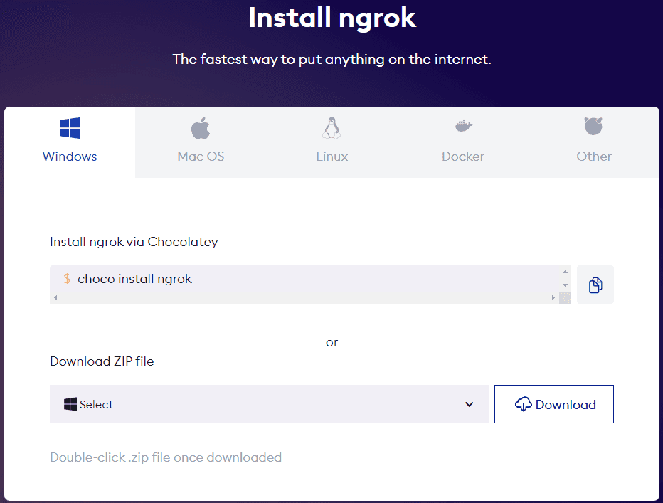
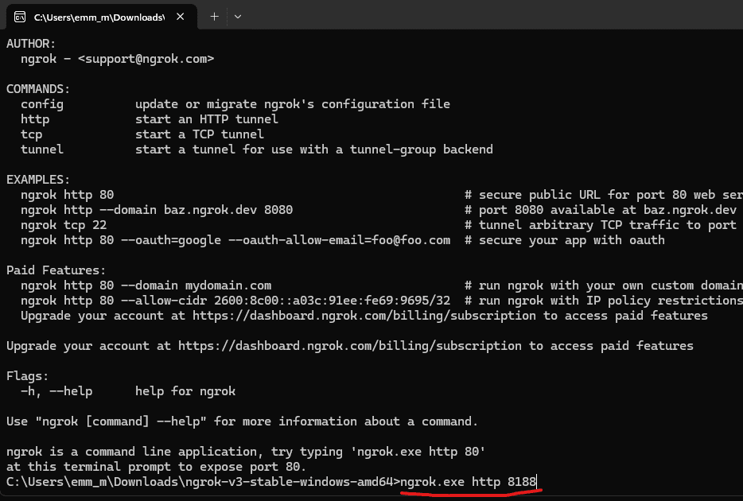
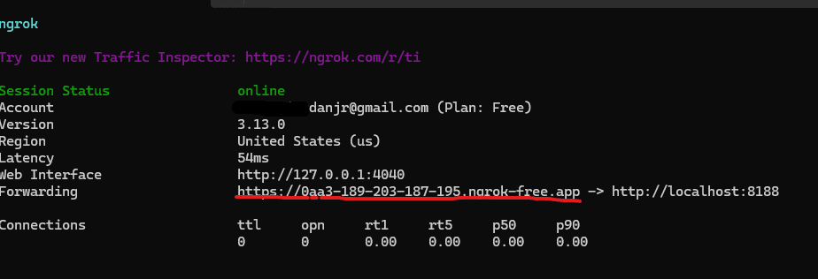
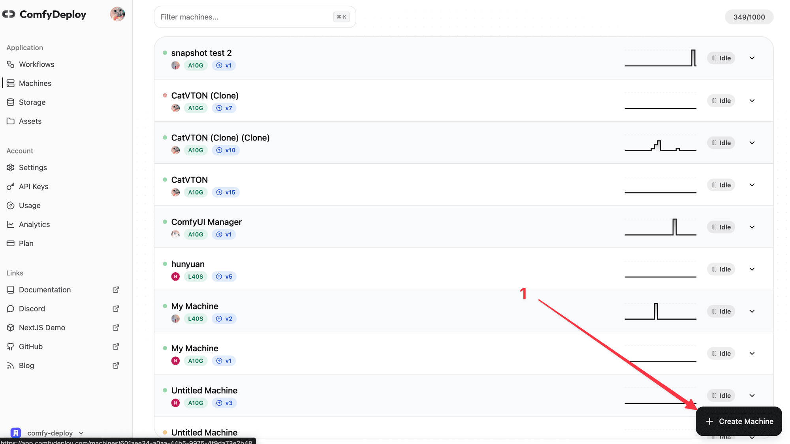
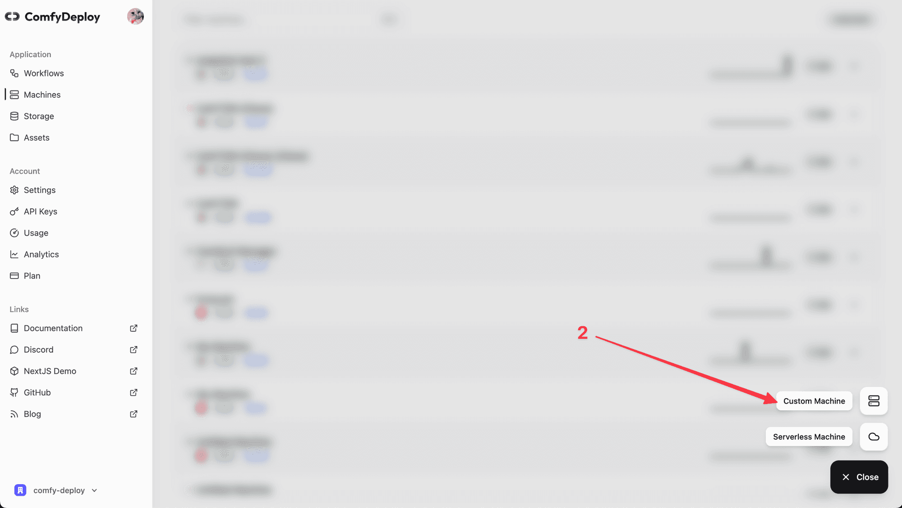
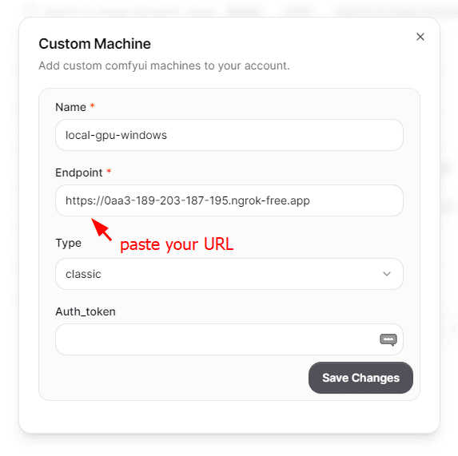
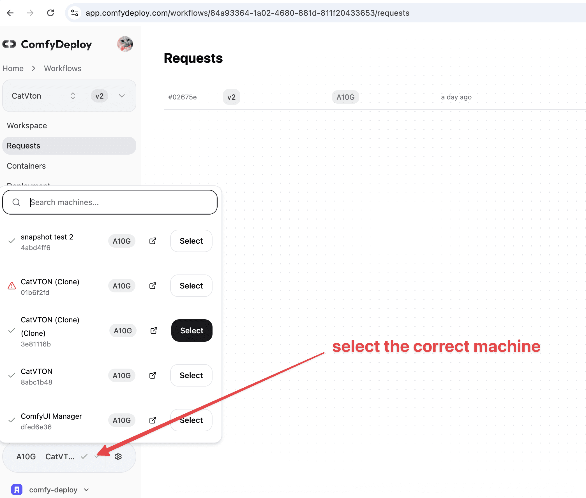

ComfyDeploy allows you to use your computer with ComfyUI installed to deploy your workflows. This guide will walk you through the process of setting up your GPU as a machine in ComfyDeploy.

## Prerequisites

- A computer with ComfyUI installed
- ngrok (we'll be using this for exposing your local ComfyUI to the internet)

## Step 1: Install ngrok

1. Download the ZIP file from [ngrok's download page](https://ngrok.com/download).
2. Extract the ZIP file to a convenient location on your computer.

## Step 2: Start ngrok and Expose ComfyUI

1. Open `ngrok.exe` (or the appropriate executable for your OS).
2. Run the following command to expose your local ComfyUI (which typically runs on port 8188):

3. After running the command, you'll see a display with various information. Look for the “Forwarding” URL - this is what we'll use to connect to your ComfyUI instance.

## Step 3: Add the Custom Machine in ComfyDeploy

1. Go to your machines page on ComfyDeploy: [https://www.comfydeploy.com/machines](https://www.comfydeploy.com/machines)
2. Click on "Custom Machine".
3. Give your machine a descriptive name.
4. Paste the forwarding URL from ngrok into the endpoint field.

## Step 4: Use Your GPU in Workflows

Now you can go to your workflow and select the machine we just configured with your GPU.

## Limitations and Considerations

When using your GPU as a machine in ComfyDeploy, be aware of that **Not all features of ComfyDeploy will work correctly with custom machines**.
