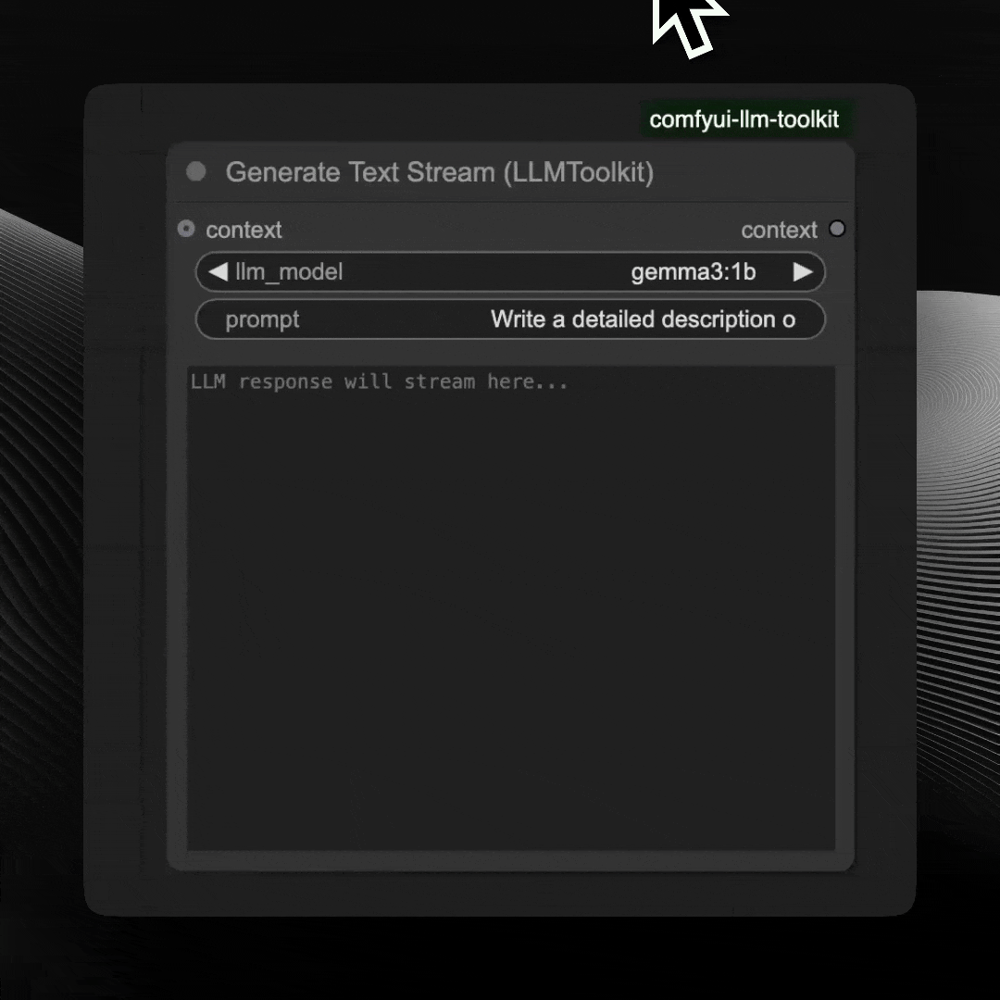
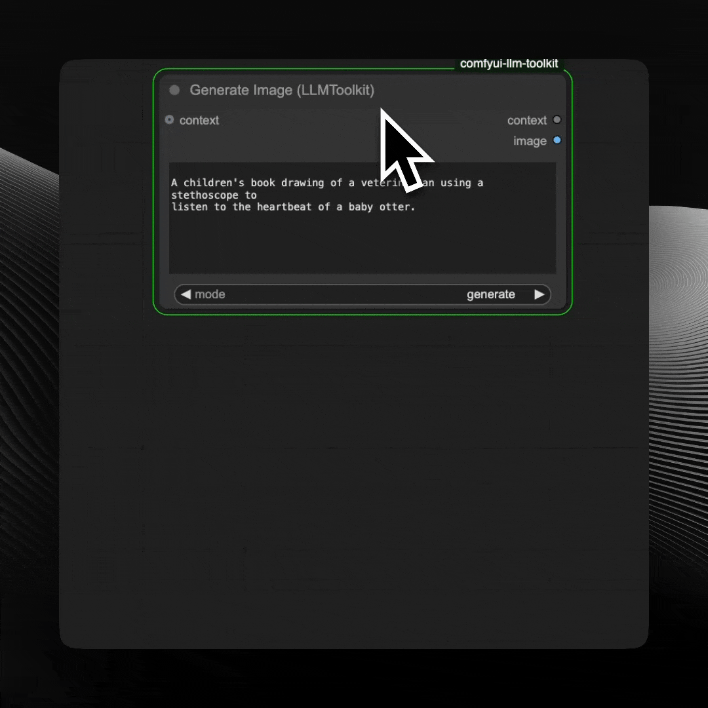
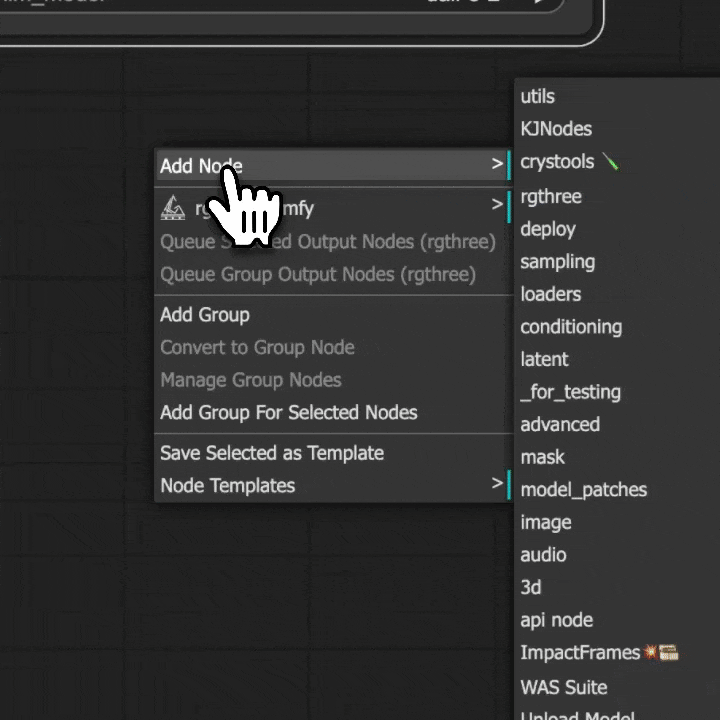
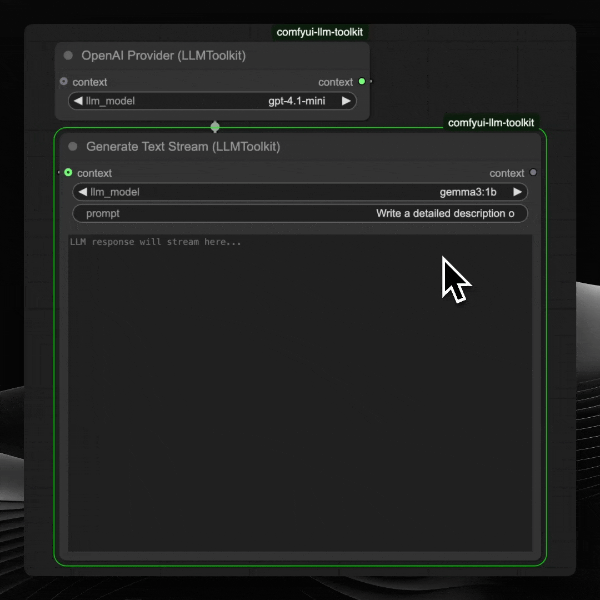
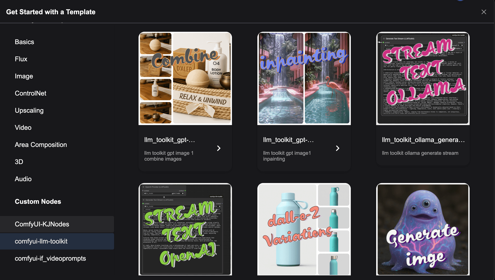
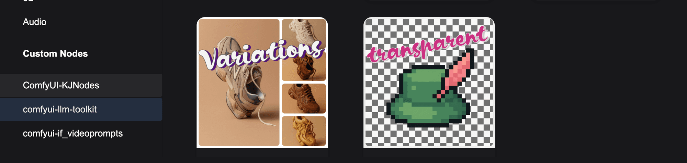
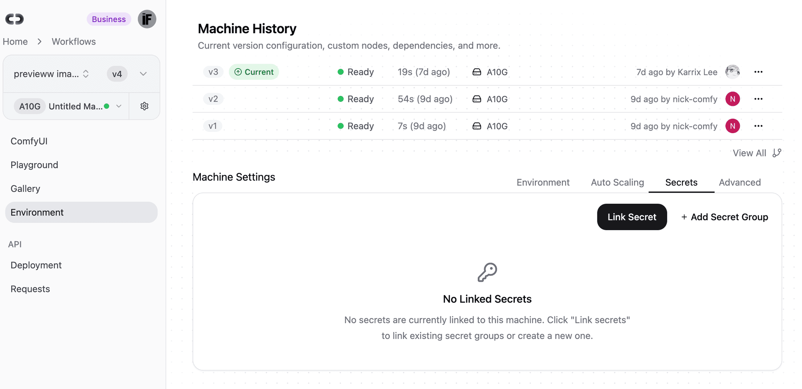

The ComfyDeploy team is introducing the LLM toolkit, an easy-to-use set of nodes with a single input and output philosophy.

The LLM toolkit will handle a variety of APIs and local LLM inference tools to generate text, images, and Video (coming soon). Currently, you can use Ollama for Local LLMs and the OpenAI API for cloud inference, including image generation with gpt-image-1 and the DALL-E series.

## Run Single

The generators, such as those for generating text and images, don't require anything connected to execute; simply place them on the canvas and run the workflow.



The generators can run without connected inputs or outputs



run image can also execute without any input or output connected

## Single Input and Output

The nodes will only contain one input and one output named "context" unless strictly necessary, and the user can agnostically change the order of connections as long as the generator is the final node before the save output. This allows for fast iteration and worry-free editing. The object dictionaries containing the configuration prompt and other information will be passed along to the next node independently of whether it is being edited or not.



inputs outputs can be place on different order

## Streaming Content



Streams the content as it is created by the LLM

## Generate Images

The Generate Images node uses the new gpt-image-1 model by OpenAI. It provides all the features available through the API, such as generating images from text and references, editing images using masked areas, and more. Test case workflows are provided and can be found in the LLM-Toolkit's template browser.



The gpt-image-1 model is heavily dependent on the quality of the prompt, so I recommend paying attention to it, especially when generating edits.
"replicates the exact reference image with ... insert your task here"


Sadly the model is not 100% consistent with the reference but the prompt "replicates the exact reference image with ... " works well.

## Environment Variables

You need to provide secrets and API keys to use cloud API providers like OpenAI. Create a .env file in the root of the `custom_nodes/comfyui-llm-toolkit` folder.

It should contain the name field and the key

```
OPENAI_API_KEY=sk-proj-_En73rY0urAp1K3yH3r3
```

In Confy Deploy, add the secrets to your machine.


