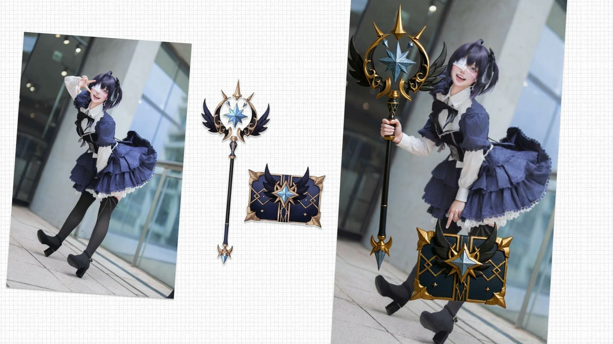
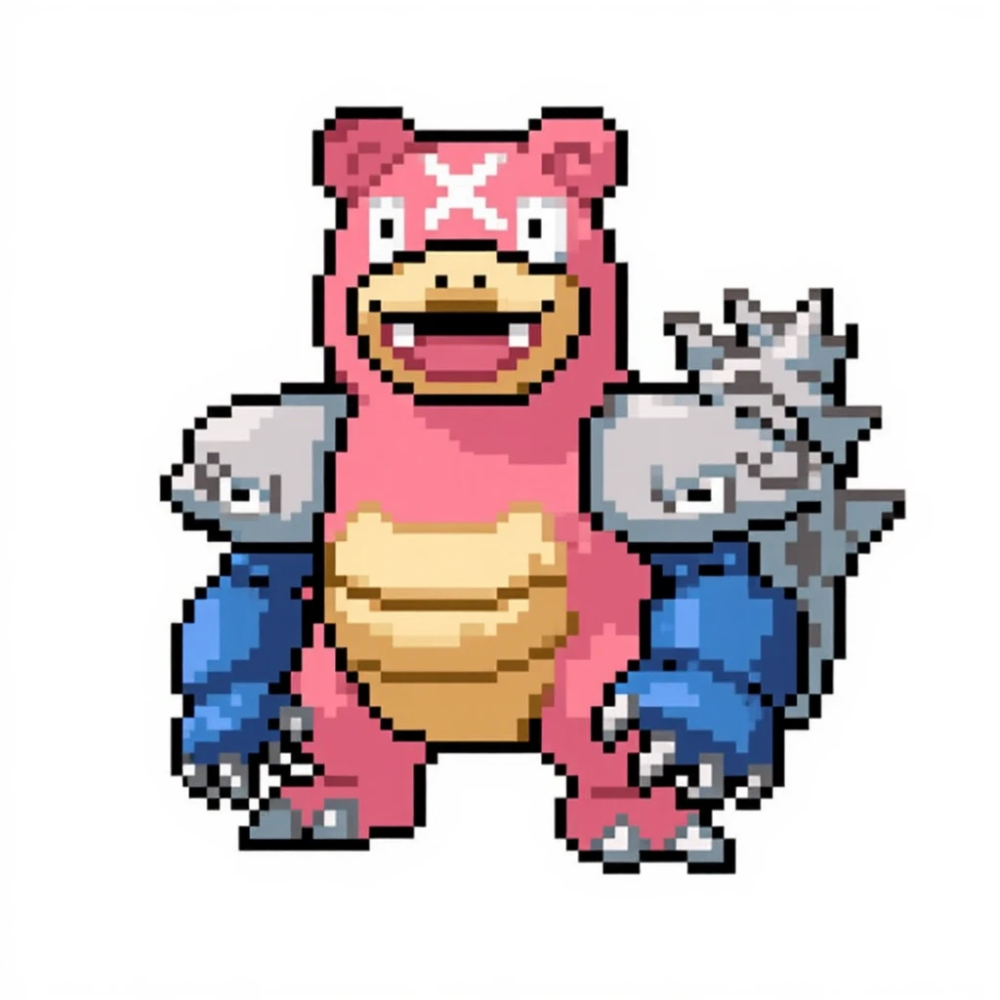

Nunchaku is a set of ComfyUI nodes and workflows that run quantized Flux models for faster image generation and editing. It is most useful with Flux Kontext, where it speeds up multi-image editing.

## What is Nunchaku?

Nunchaku is a high-speed image generation and optimization toolkit for Flux models in ComfyUI. It combines quantized FluxDiT models, automatic prompt generation, and streamlined processing. The name refers to the martial arts weapon known for speed and precision.

Nunchaku is built around the **svdq-int4-flux** quantized model. Workflows can also generate prompts automatically with JoyCaption and Meta-Llama-3.1-8B, which helps when you want to imitate the style of an existing image. It covers portrait generation, image-to-image transformations, and multi-image editing.

Nunchaku works with [FLUX.1 Kontext Dev](/blog/flux-kontext-dev) and other Flux models. It uses the quantized FluxDiT (svdq-int4), T5-XXL and CLIP encoders for text understanding, and specialized nodes for image processing. The project is open source, and the code is on [GitHub](https://github.com/nunchaku-tech/ComfyUI-nunchaku).

## Key features of Nunchaku in ComfyUI

- **Quantized FluxDiT performance.** The svdq-int4-flux model gives faster inference while keeping image quality high, which helps with rapid iteration and production workflows.
- **Automated prompt generation.** JoyCaption with Meta-Llama-3.1-8B converts an image into a prompt, which supports image imitation and style transfer.
- **Specialized nodes.** The workflows use FluxGuidance, ModelSamplingFlux, and KSampler, configured for 20-step generation with the Euler sampler.
- **Portrait and character work.** Workflows include skin enhancement and 4K upscaling. Guides on the Nunchaku portrait workflow report about 3x faster processing.
- **GPU memory management.** Cleanup nodes such as cleanGpuUsed free GPU memory, which helps with large images and complex workflows.

## Nunchaku ComfyUI workflows

These workflow templates cover common Flux Kontext editing tasks with Nunchaku. Open any of them to see the nodes, run it, or fork it into your own project.

### Faster Kontext Dev: edit two images

The [Faster Kontext Dev workflow](/workflows/faster-kontextdev-edit-two-images-with-nunchaku) edits two images together with a Nunchaku-quantized Kontext model.

### Kontext Presets (Nunchaku)

The [Kontext Presets workflow](/workflows/kontext-presets-local-nunchaku) applies the Black Forest Labs Kontext presets, plus ComfyDeploy presets, to your images using Nunchaku.

### Nunchaku fast and simple Kontext editing

The [Nunchaku fast and simple Kontext editing workflow](/workflows/nunchaku-fast-simple-kontext-editing) is a multi-image editing workflow that uses the Flux Kontext model for image-to-image transformations and object integration. It includes optional background removal, image resizing, and LLM-assisted prompt generation, and it uses the Euler sampler.

You can find more in the [Flux Kontext workflows](/workflows/model/flux-kontext).

## Nunchaku technical architecture

**Core components**

- **svdq-int4-flux** quantized FluxDiT model
- **T5-XXL and CLIP-L** encoders (fp8_e4m3fn)
- **4x-UltraSharp** upscaler integration

**Workflow features**

- **Image-to-prompt** with JoyCaption
- **20-step generation** with the Euler sampler
- **GPU cleanup** and memory optimization

## Why use Nunchaku?

Nunchaku suits creators who want fast image generation without giving up flexibility, from portrait enhancement to multi-image editing. It needs little setup, and the quantized model reduces generation time.

To learn more, read these guides on comfyui.org: [High-Speed Image Generation](https://comfyui.org/en/unlock-high-speed-image-generation-nunchaku-flux) and [Portrait Generation Guide](https://comfyui.org/en/turbocharge-portrait-generation-with-nunchaku).
