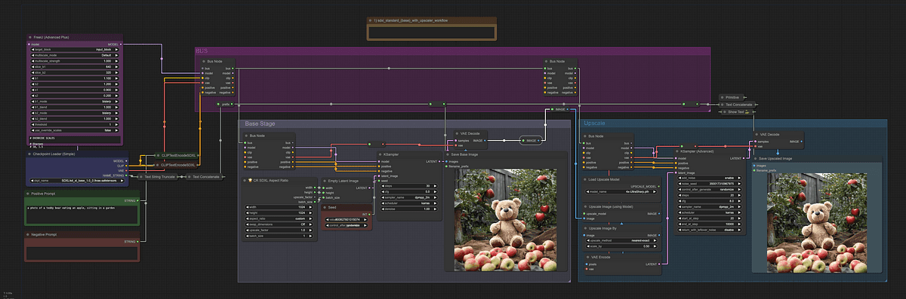
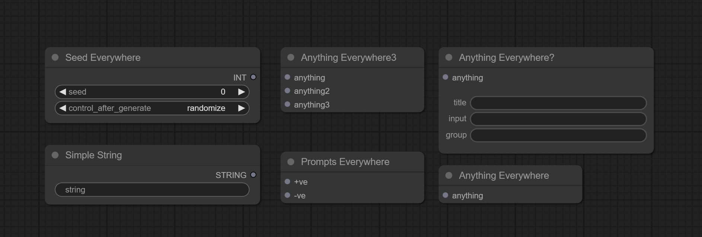
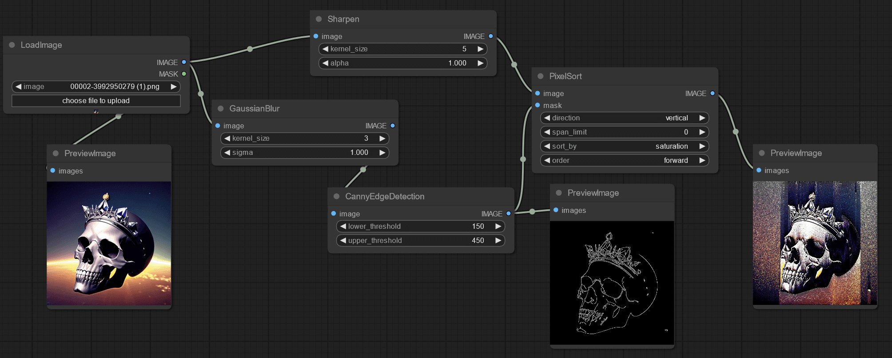

Custom node collections in ComfyUI are curated sets of user-created nodes that extend the platform’s functionality. They allow users to tailor their image generation workflows to specific needs.

These collections are central to ComfyUI’s modular and community-driven approach. They enable both developers and end-users to enhance and customize their experience.

## What Are Custom Nodes in ComfyUI?

A custom node in ComfyUI is a Python class that defines a specific operation or function within a workflow. Each custom node must specify:

Custom nodes: the building blocks of ComfyUI workflows.

- CATEGORY: Determines where the node appears in the "add new node" menu.
- INPUT\_TYPES: A class method that defines the expected inputs for the node.
- RETURN\_TYPES: Specifies the outputs produced by the node.
- FUNCTION: The method executed when the node runs.

For example, a custom node might process a batch of images and return the one with the lightest color.

The flexibility of custom nodes allows users to implement virtually any logic or data transformation required for their workflows.

## How Custom Node Collections Work

Custom node collections are organized groups of these user-defined nodes. They are typically distributed as folders or packages containing:

Organized nodes streamline workflows and enhance efficiency.

- One or more `.py` files defining the node classes.
- A mapping dictionary (NODE\_CLASS\_MAPPINGS) that links node names to their classes.
- Optionally, a human-readable display name mapping (NODE\_DISPLAY\_NAME\_MAPPINGS).
- An `__init__.py` file to signal to ComfyUI where to find these mappings.
- A `requirements.txt` file if additional dependencies are needed.

This structure makes it easy to share, install, and manage sets of nodes as a single unit. It streamlines workflow customization and collaboration.

## The Role of the ComfyUI Registry

The ComfyUI Registry acts as a public repository for custom node collections. It provides several key benefits.

A hub for sharing and accessing custom node collections.

Users can search for and discover custom nodes that fit their workflow needs. Developers can publish new versions, and users can lock workflows to specific node versions for reproducibility.

Nodes are scanned for malicious behavior, and verified nodes are flagged for user confidence. Additionally, users can rate and provide feedback on nodes, fostering a collaborative ecosystem.

By standardizing how custom nodes are published and managed, the registry ensures that workflows remain stable and secure even as the ecosystem evolves.

## Managing and Installing Custom Node Collections

ComfyUI provides a Manager interface that simplifies the installation and management of custom node collections.

Through this GUI, users can install or uninstall custom nodes, install missing nodes required by a workflow, and update all installed nodes and ComfyUI itself with a single click.

Simplifying node management with a user-friendly GUI.

This user-friendly approach lowers the barrier for both new and experienced users to experiment with and adopt new functionality.

## Why Custom Node Collections Matter

Custom node collections empower users to extend ComfyUI’s capabilities beyond its core features.

They allow users to share specialized tools and workflows with the community. They also enable rapid prototyping and iteration on new ideas without waiting for official updates.

By leveraging custom node collections, the ComfyUI community can address a wide range of creative and technical challenges. This makes the platform highly adaptable and future-proof.
